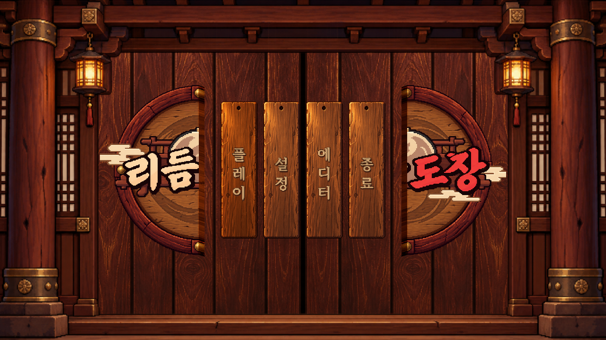
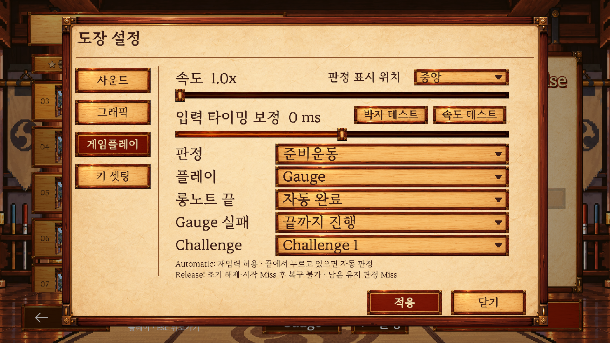
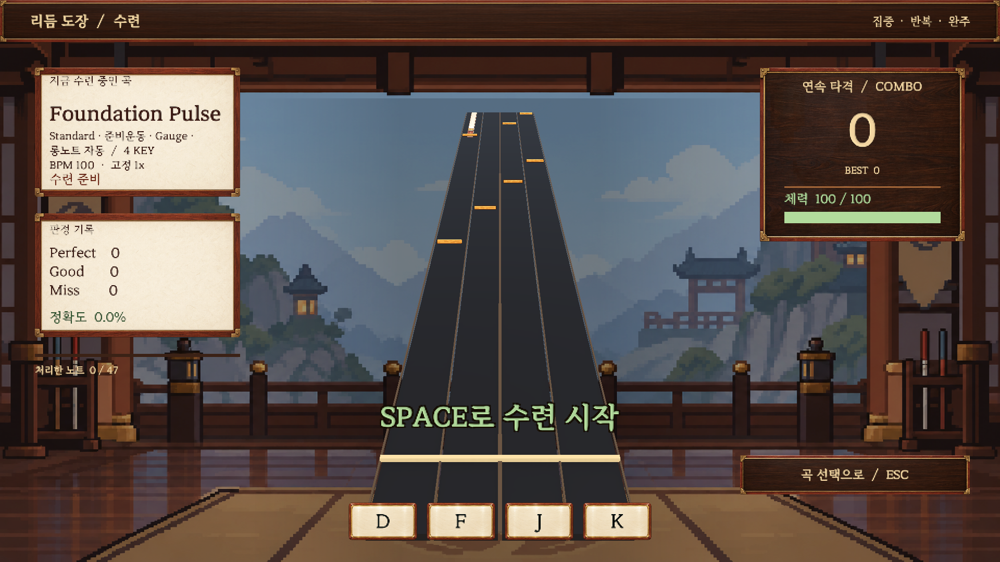
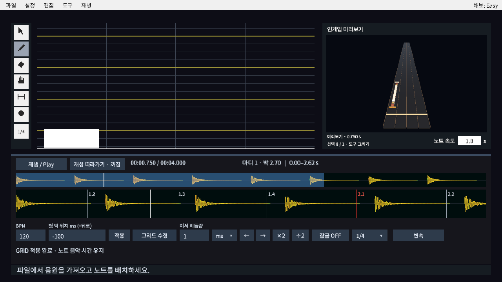
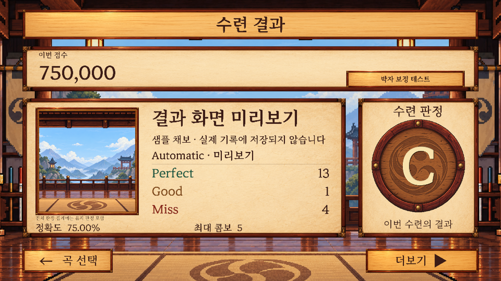

# PR #15–#21 통합 검증

## 통합 범위

기준 main은 `bdd3bab`이며 #13 에디터 변경을 포함한다. `integration/pr-15-21-common-contracts`는 #15–#21의 기존 구현 이력을 병합하고 #16의 별도 지침 커밋 `e52fc65`를 추가로 포함한다. 기존 PR의 병합·종료는 수행하지 않는다.

공통 수정은 판정 시간·보정 표본(`1fd9183`), 로딩 오류(`98a9d92`), 텍스트 역할(`aa6d450`)로 분리하였다. 후속 커밋에는 복구·비동기 요청 회귀, 생성 에셋, 문서와 검증 결과를 포함한다.

## 리뷰 항목별 조치

| 원본 | 문제 | 통합 수정 및 검증 |
| --- | --- | --- |
| #15 | 저장 씬의 이전 글꼴 참조, smooth 전환 후 픽셀 머티리얼 잔존, 단일 글꼴·Bold 테스트 | `UiTextStyle`의 Title/Body/Help를 Bold/SemiBold/Regular에 연결하였다. 이름 추론을 제거하고 반복 적용, 비활성 트리, scope 순서, pixel↔smooth, 커스텀 글꼴·머티리얼 보존을 검사하였다. 빌더와 씬 7개·SettingsPopup을 함께 이관하였다. |
| #16 | +200ms 보정에서 자동 롱노트 검사가 입력보다 먼저 진행 | `GameplayTiming`으로 입력·Tick의 논리 시각을 통일하고 별도 자동 종료·시작 timeout 보정을 제거하였다. 0/±200ms, 짧은 Hold, 유지 간격보다 큰 보정, BPM 변경, 경계·재입력·일시정지·재개를 검사하였다. |
| #18 | JSON 누락을 음원 누락으로 표시 | 프로젝트 읽기와 음원 로딩 경계에서 `SongLoadFailure`를 분류한다. 실제 임시 프로젝트의 JSON 삭제·음원 삭제·잘못된 JSON을 구분하고 복구 후 새로고침을 검사하였다. |
| #20 | 동시타 첫 레인에 따른 보정 추천 편향 | `TimingSampleSet`이 같은 시작 시각을 한 표본으로 집계한다. 중앙값을 사용하며 내부 범위가 50ms를 초과하면 추천하지 않는다. 12시점의 +40/−40ms 동시타, 순서·중복 개수 변경, 표본·성공률·비유한 값·변경량 제한을 검사하였다. |
| #17·#19·#21 | 앞선 변경과 함께 유지할 기능·회귀 범위 | 기존 구현을 병합하여 유지하고 설정·결과·곡 선택·입력·오디오 회귀를 전체 검증에 포함하였다. |

## 공통 계약

입력 시각 변환은 이미 보정된 `InputTimeToSongTime` 반환값을 그대로 사용한다. Tick은 곡 시각에서 같은 보정값을 차감한다. Presenter가 없는 경우에도 같은 타임스탬프 입력을 7/90/400ms Tick 간격으로 실행하여 판정 이벤트·점수·콤보·체력·완료 상태를 비교한다. 일시정지 시 논리 시각을 보관하고 대기 해제를 재개 후 한 번 반영한다. 규칙 버전은 4이며 기존 `RecordIdentity`로 버전 3 기록을 보존·분리한다.

결과 추천은 해당 플레이의 보정값을 기준으로 기존 `InputTiming.RecommendOffsetMs`를 호출한다. 설정 측정은 박자별 한 표본·최소 8개·기준값 0을 유지한다. 결과의 최소 12시점·성공 시점 70%·변경량 5ms·±200ms 제한을 유지하며 저장은 적용 동작에서 수행한다.

채보·음원 오류는 라이브러리를 지나도 구조화된 종류와 원인 예외를 유지한다. 취소는 오류로 변환하지 않는다. 곡 선택·미리듣기·결과 재도전은 `SongLoadErrorDisplay`를 공유한다. 늦게 완료한 요청의 음원 해제와 이전 결과 화면의 재시도 실패 무시를 검사하였다.

기존 공개 생성자·메서드와 직렬화 필드를 유지하였다. Domain/Application의 Unity 비의존성은 자동 검사에 포함된다. 기존 `.meta` 변경은 없으며 새 타입·에셋에 필요한 메타데이터만 추가하였다. 검증용 곡과 채보는 재생성하지 않았다. 에디터의 NotoSans 설정을 유지하였다.

## 실행 결과

이번 통합 소스·에셋은 `d7bf0fe`이며 이후 `2c59e42`는 문서 변경이다. Windows의 별도 검증 사본에서 Unity 6000.3.23f1을 실행하였다. 노트북과 검증 사본의 Assets/Packages/ProjectSettings 추적 파일 855개의 SHA-256을 비교하여 불일치가 없음을 확인하였다. 원래 Windows 프로젝트와 로컬 음원은 검증 사본과 분리하였다.

2026-11-09에 최종 **Game Tools > Verification > Verify All Tests (No Build)**를 실행하여 Domain/EditMode **471/471**, PlayMode **234/234**, 합계 **705/705** 통과하였다. 실패·건너뜀·불확정은 모두 0개다. 하나의 전체 실행 결과이며 부분 재실행을 합산한 수치가 아니다. EditMode는 13:45:22–13:46:10, PlayMode는 13:46:16–14:03:13(KST)에 실행하였다.

[테스트별 결과와 실행 시각](verification-data/integration-pr-15-21.json)을 보관한다. 실행 전후 추적 파일 855개의 해시 불일치는 모두 0개였다. 원래 Windows 프로젝트의 HEAD·브랜치·미커밋 변경 목록과 로컬 음원 크기도 작업 전 상태를 유지하였다.

관련 범위의 선행 검증은 Domain 238/238, UiTypographyTests 12/12, SongLoadFailureTests 3/3, TeamBoundaryTests 14/14, PlayResultReviewTests 10/10, PlayRecordsAndChartsTests 5/5, 늦은 미리듣기 해제 1/1, 복구한 실제 음원 로딩 1/1, GameplayPauseFlowTests 3/3, ResultsFlowTests 필터 17/17, SettingsFlowTests 16/16이다. 이 수치는 전체 실행과 중복되므로 합산하지 않는다.

실제 Unity 음원 디코더에 손상된 WAV를 전달한 별도 진단에서 `AudioLoadFailed`, 원인 `IOException`, 재시도 허용을 확인하였다. 초기 회귀 실행에서는 비동기 테스트의 동기 대기와 취소 예외의 정확한 타입 단언을 수정하였고, 누락된 Docs 예제 fixture를 검증 사본에 전달한 뒤 관련 범위를 재실행하였다. 과거 PR의 통과 수치는 이번 결과에 사용하지 않는다.

## 화면 검토와 미확인 사항

메인 메뉴·설정·게임플레이·에디터·결과 이미지에서 제목·본문·도움말과 한글 표시를 검토하였다. 화면 이미지는 기존 테스트 캡처 도우미의 원격 Unity 오프스크린 렌더링 결과이며 실제 모니터를 직접 확인한 결과가 아니다. 빈 결과 화면 CLI 캡처는 검증 자료에서 제외하였다. 결과 이미지는 기존 `ResultsPreview.CreateResult`의 샘플을 표시한 후 같은 캡처 도우미로 생성하였으며 실제 플레이 기록이 아니다.

Windows에서 실제 포커스 복귀 후 오디오 재개·스피커 출력·글꼴 표시를 직접 확인하는 단계는 미확인이다. 사용자가 현재 직접 확인할 수 없다고 답변하여 미확인으로 기록하였다. 자동 포커스·오디오 회귀와 렌더링 검사는 이 단계를 대체하지 않는다. Windows 플레이어 빌드는 이번 요청 범위에 포함하지 않아 실행하지 않았다.

EOD
