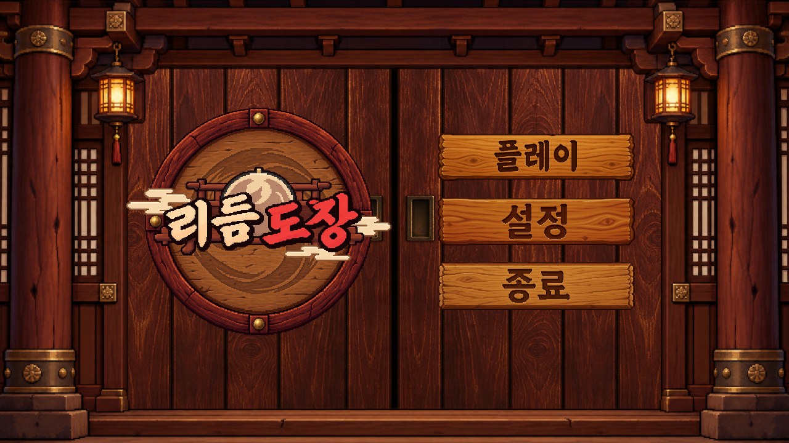
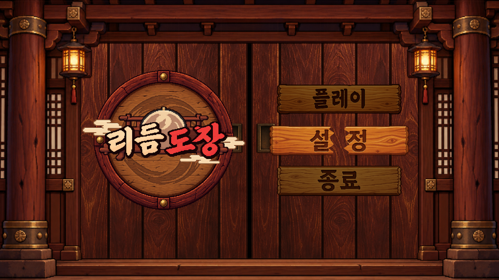
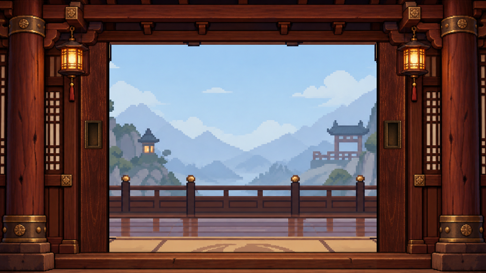
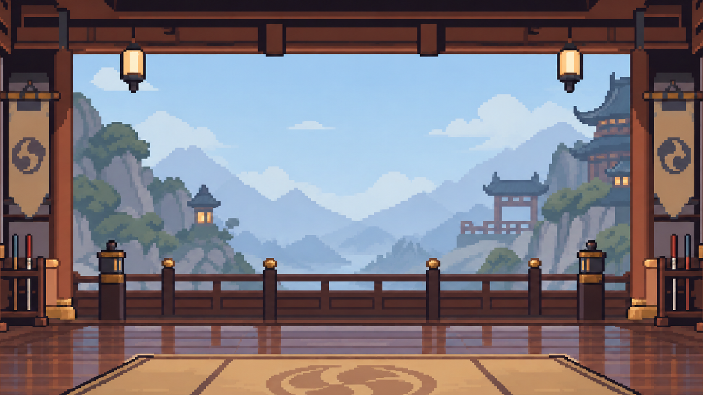

# Dojo entrance title

The title starts with closed wooden sliding doors. The existing game logo sits over a round carved wooden plaque. Only the logo artwork pulses with the music; the wooden plaque and start prompt retain their scale. The short knock rotation also applies only to the logo artwork. The whole plaque/logo assembly still moves left when opening the menu. Clicking or submitting the plaque gives a short wood knock and moves it left over 0.25 seconds, revealing three vertically stacked boards on the right. Clicking the plaque again collapses the menu. Transparent corners of the plaque and the background do not activate it.

The boards read **플레이 / 설정 / 종료** in the artwork. A click locks the menu immediately, opens a jagged crack, and separates the original image into left/right pieces over 0.25 seconds. Settings and Quit execute only after the split. Returning from settings or canceling Quit restores all boards and the expanded menu.

Play then fades the logo/menu for 0.15 seconds and requests the existing Title → Bootstrap → SongSelection navigation. A persistent presentation canvas covers Bootstrap with the same dojo landscape and opens the doors over 0.55 seconds. Once song selection has initialized, the nearby frame moves beyond the screen edges while the landscape zooms by 8% over 0.85 seconds. The selection backdrop uses the same final scale and source-image aspect ratio, so the landscape keeps its framing across the handoff. The overlay fades only near the end of the approach; selection panels fade in and settle upward over 0.6 seconds, independently of the background. Selection pointer and keyboard input remain locked until the 1.2-second reveal completes. Slow loads keep the landscape visible; a 20-second readiness timeout presents a return-to-title button. Ordinary selection entry paths do not animate.

## Assets

Built-in image_gen originals live in `Assets/Game/Art/DojoEntrance/`: EntranceFrame, DoorPanel, RoundPlaque, PlayBoard, SettingsBoard, QuitBoard. The right door mirrors the same panel, preserving consistent grain and matching hardware. Full prompts are in [dojo-entrance-prompts.md](dojo-entrance-prompts.md). Existing TitleLogo and TitleBackground remain in use.

`DojoEntranceAssets` creates stable matching `.asset` sprites, crops transparent outer padding for plaque/boards, and preserves PNG pixels. Point filtering and uncompressed alpha retain pixel edges. `DojoBoardFragments` splits the original sprite UVs along a jagged seam; no separately generated replacement lettering or texture is used.

Three original synthesized mono WAV effects live in `Assets/Game/Audio/`: DojoKnock (0.16 s), DojoBoardCrack (0.25 s), DojoDoorSlide (0.55 s). Reproduce them with `python Tools/generate_dojo_audio.py`. They use decaying wood resonances and filtered noise, with no third-party samples. Existing title music and master volume remain in use.

## Authoring and verification

`MainMenuLayoutBuilder` is authoritative; use **Game Tools > Scenes > Build Title** after layout changes. Do not hand-edit the generated scene. Existing public view names and `IMainMenuActions` remain compatible. New view references identify the entrance, door panels, logo group and effect clips; Core owns navigation, while UI owns animation.

Run MainMenuTests, MainMenuFlowTests, and DojoClickFeedbackTests after changes. Main-menu tests capture closed/expanded states at common aspect ratios, the breaking board, and the quit popup into Logs. They exercise real mouse raycasts, hidden buttons, delayed actions, repeated clicks, settings restoration, Bootstrap traversal, readiness waiting, timeout recovery and input restoration.

## Captures

## Verification result (2026-10-20)

After the transition refinement, MainMenuFlowTests passed 12/12 and Smoke passed 4/4. This includes matching the entrance's final backdrop corners against the real song selection backdrop, panel-only animation, input restoration, and timeout recovery. These were targeted checks; the earlier full-run evidence below does not cover the later transition refinement.

Unity 6000.3.23f1 compiled successfully. Targeted checks passed: MainMenuTests 5/5 and MainMenuFlowTests 12/12. The completed Foundation run passed all 195 EditMode and 94 PlayMode tests with no failures or skips, including click audio and navigation smoke coverage. Windows standalone build succeeded at `Builds/Windows/RhythmDojo.exe` with Title as entry point. Evidence: `Logs/verification-editmode.xml`, `Logs/verification-playmode.xml`, and `Logs/verification.txt`.

Closed screens were inspected at 16:9, 16:10, 4:3 and ultrawide sizes; expanded boards, the visible fracture mesh, and opening/open doors were also inspected. Generated Unity metadata is present for all new assets. Unrelated clean scenes rewritten by the full suite were restored after confirming their serialized values differed only in generated object IDs/order.
