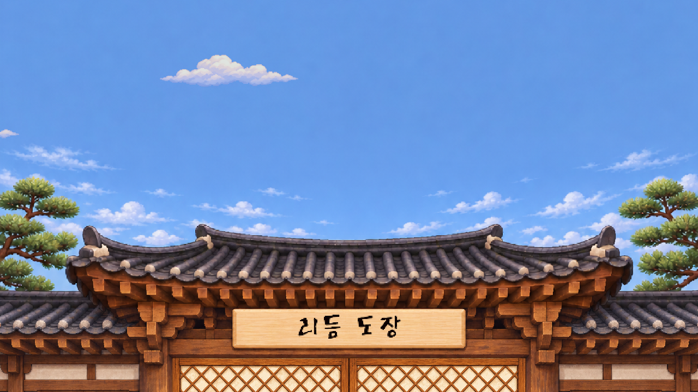

# Dojo entrance title

## Continuous sky-to-dojo landscape (2026-11-14)

The current Title uses one 1672 × 2039 landscape, `Assets/Game/Art/TitleSky/Sky.png`. `SkyUpper.asset` and `SkyEntrance.asset` sample adjacent regions of this same texture. `TitleSkyLayoutBuilder` derives their travel distance and matching vertical pixel scale from the source dimensions; it no longer blends eight rows between unrelated images. The completed roof ridge, pine crowns, clouds and sky come from the localized outpaint in `LandscapeSource.png`. The original `HanokEntrance.png` remains untouched. Its facade from source row 190 through the bottom, including the plaque, columns, windows, drum, sword rack, paving and doorway alpha, is restored into the master during the editor bake. The doors remain separate original sprites.

The title alone uses `DojoCompositionFit.coverViewport` so the whole outdoor scene fills the viewport with one uniform scale. Different aspect ratios crop its outer edges instead of revealing an unrelated indoor matte around the descending sky. The sky logo stays on the viewport canvas and remains readable in narrow windows. Other room compositions retain their previous fit. The existing logo fade, 2.6-second descent, animated clouds and swallows, door opening, approach, cancellation and return flow remain in place.

Use **Game Tools > Scenes > Build Title** to reproduce the master, sprite slices and scene. The bake uses point sampling, no mipmaps and no color blend. The [generation record](title-landscape-generation.json) contains the exact built-in `image_gen` prompt, input canvas, saved assets and preservation boundaries. The sections below document earlier entrance iterations; the current scene transition is Title → ModeSelection.

Validation used Unity 6000.3.23f1: the relevant EditMode menu checks, PlayMode entrance/cancellation cases and Smoke suite passed with no skips or inconclusive results ([EditMode](../Logs/title-landscape/editmode.json), [entrance](../Logs/title-landscape/doors-playmode.json), [cancellation](../Logs/title-landscape/cancel-playmode.json), [Smoke](../Logs/title-landscape/smoke-playmode.json)). This was scoped verification, without a player build. The six render sizes 1280×720, 1920×1080, 1024×768, 1920×1200, 2560×1080 and 720×1280 were checked at nine descent positions each. The split stayed within 0.01 screen pixels with matching pixel scales. All 885,268 visible protected facade pixels and 1,255,672 alpha values matched the original imported artwork. The actual controller sequence was captured in 59 frames and inspected throughout the descent, door opening and room handoff ([video](../Logs/title-landscape/camera-descent.mp4), [frame timings](../Logs/title-landscape/motion.csv), [pose checks](../Logs/title-landscape/pose-checks.txt), [pixel audit](../Logs/title-landscape/asset-audit.txt)). The recording is a visual inspection aid; rendering captures adds overhead and is not a performance measurement.

## Sliding doors and training menu

The closed title preserves the existing DoorPanel, EntranceFrame, RoundPlaque and TitleLogo sprites. Clicking the screen or submitting the plaque splits only the plaque and logo over 0.85 seconds with SmoothStep easing; the doors remain fully closed. Each logo half moves 220 reference units onto its corresponding door, leaving the center clear for the menu. DojoSlidingImage draws the halves directly from the original sprite UVs, and the logo retains its music pulse. The doorway clip and foreground columns occlude artwork at the sides.

Four 80 × 290 vertical wooden plaques appear side by side in front of the closed doors: Play / Settings / Editor / Quit. VerticalMenuBoard artwork follows the user's rustic wooden menu reference with worn edges, detailed upright grain and a hanging hole; cream Mona captions read vertically. The row fits between the separated logo halves. TrainingDummy objects and the decorative TrainingHallPlaque are no longer generated. The existing TrainingInterior remains behind the doors for the entrance sequence. Source art assets are preserved.

The menu renders above the closed doors and below the logo clip, so both logo halves naturally cover the plaques throughout opening and reversal. It receives pointer input only after the logo split completes. Clicking empty space reverses the logo animation continuously without opening the doors. Up/down and left/right keyboard navigation follow the four plaques, and focus moves to Play after revealing the menu. Existing press delay, duplicate-action protection, settings popup and quit confirmation behavior remain in place. Settings return and quit cancellation restore the menu with the doors still closed.

Play uses the existing Title → Bootstrap → SongSelection flow. After the menu fades, the persistent transition opens the doors over 1.4 seconds using quintic smootherstep, with zero velocity and acceleration at the start and end, then approaches the doorway. It retains the separated logo and plaque at their initial positions while the doors begin opening. Once each door's central seam reaches the corresponding logo half's split edge, that half follows the door seam without an additional offset. DojoEntranceView uses the greater of the initial menu separation and current door displacement and compensates for the logo's local scale. Both halves remain visible until carried offscreen; they are not faded or deleted at the start of the transition. The copied menu is removed and Button components are disabled/removed without deleting logo artwork. Readiness waiting, timeout recovery, final backdrop framing and selection input restoration retain their existing behavior.

## Authoring

MainMenuLayoutBuilder is authoritative. Use **Game Tools > Scenes > Build Title** after layout changes. Do not hand-edit the generated scene. Existing view field names and IMainMenuActions remain compatible. Core owns navigation; UI owns the animation. Existing DojoBoardBreak assets and scripts remain available.

## Verification

Scene activation and song/UI initialization finish behind the closed cloned doorway before motion begins. DojoEntranceTransition waits for SelectionReady, settles canvas/font work over two frames, and then starts its 1.4-second opening clock and slide audio. Loading time never advances visible door motion. The readiness timeout starts while waiting behind the closed doors. This prevents Bootstrap/SongSelection activation stalls from interrupting the animation.

Run MainMenuTests and MainMenuFlowTests, followed by the Smoke category for scene composition changes. Set the Editor process environment variable RHYTHM_DOJO_SKIP_CAPTURE=1 before running MainMenuFlowTests when screenshots are not requested. This disables its capture helper, including the existing capture-named test; interaction assertions still run. Smoke does not require a player build.

Regression tests exercise screen input, logo reversal while doors stay closed, early Play rejection, menu input, and the retained logo's alignment with moving doors through full opening. Existing tests cover real mouse raycasts, keyboard input, settings restoration, quit confirmation, duplicate clicks, Bootstrap traversal, selection readiness and recovery.
