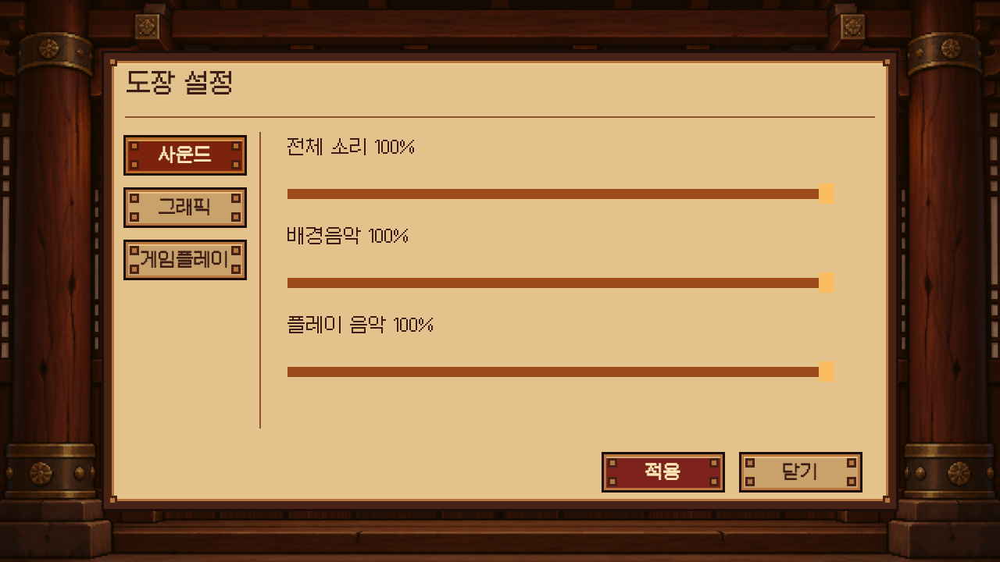

# 설정 팝업

타이틀과 곡 선택 화면의 설정 버튼은 현재 화면을 유지한 채 목재·한지 스타일 설정 팝업 하나를 엽니다. 타이틀에서 열면 설정 씬의 별도 풍경 배경을 숨겨 닫힌 나무 문 위에 반투명 음영과 팝업을 표시합니다. 곡 선택에서 열거나 설정 씬을 직접 실행하면 기존 풍경 배경을 유지합니다. 왼쪽 사운드·그래픽·게임플레이 탭으로 내용을 전환합니다. 팝업이 열린 동안 배경 화면의 입력을 차단하고, 닫기 또는 Esc로 이전 화면과 포커스를 복구합니다. 드롭다운을 펼친 상태의 Esc는 목록부터 닫습니다.

- 사운드: 전체 소리, 배경음악(타이틀 음악), 플레이 음악을 각각 0~100%로 조절합니다. 전체 소리는 모든 오디오에, 나머지는 각 음악 소스의 기존 기본 볼륨에 곱해집니다. 볼륨은 즉시 적용하고 저장합니다.
- 그래픽: 화면 비율(16:9·16:10)과 해상도(FHD·QHD)는 별도 목록입니다. FHD는 높이 1080, QHD는 높이 1440을 기준으로 선택 비율에 맞춰 가로 크기를 계산합니다. 16:9는 1920×1080·2560×1440, 16:10은 1728×1080·2304×1440입니다. 선택한 크기와 현재 실제 화면 크기를 목록 아래에 별도로 표시합니다.
- FPS: 30·60·120·144·240·제한 없음. FPS 제한을 적용할 때 VSync를 해제합니다. 현재 적용된 FPS 제한과 0.5초 단위로 측정한 실제 FPS를 표시합니다. 높은 FPS를 선택해도 장치 성능에 따라 실제 FPS는 제한값보다 낮을 수 있습니다.
- 게임플레이: 속도(1.0~10.0x, 0.1x 단위)와 입력 타이밍 보정(-200~+200ms)을 조절합니다. 변경 즉시 `RhythmDojo.Selection.v1`에 저장하며, 팝업을 닫거나 곡·난이도를 바꿔도 유지합니다. 양수 보정은 입력 시각에서 보정값을 빼는 기존 방식입니다. 메인 화면에는 이 두 조절 UI를 표시하지 않습니다.
- 기존 DSP 버퍼 목록, 실제 DSP 상태와 적용 기능은 그래픽 탭에 유지합니다. 목록 선택만으로 오디오 장치를 재설정하지 않습니다. DSP 버퍼 선택은 기존처럼 실행 중에만 유지됩니다.

사운드·게임플레이 탭의 적용 버튼은 다른 탭의 대기 중인 그래픽·DSP 설정을 적용하지 않습니다. 그래픽 설정은 그래픽 탭의 적용 버튼으로 반영하고 저장합니다. 화면 크기 변경은 실행 게임에서는 창 모드에 적용하고, Unity 에디터에서는 Game View의 고정 해상도에 적용합니다. 에디터에서는 하나의 Rhythm Dojo Settings 해상도 항목을 재사용합니다. Game View가 화면에 맞게 축소 표시되더라도 실제 렌더링 크기는 선택한 해상도입니다. 저장 키는 `RhythmDojo.Presentation.v1`이며 기존 곡 선택 옵션의 저장 키와 이름은 유지합니다. 화면 원본은 기존 `SettingsLayoutBuilder`이고 Game Tools > Scenes > Build Settings로 재생성합니다.

사운드 설정은 타이틀 첫 진입에서도 저장된 전체 볼륨을 복원하며, 재생 중인 플레이 음악에도 볼륨 변경을 즉시 반영합니다. 현재 `Assets/Game/Settings/TitleMusic.asset`의 음악 클립은 미지정이므로 타이틀 배경음악은 재생되지 않습니다. 배경음악 볼륨 경로는 테스트용 오디오를 통해 출력 감소와 음소거를 검증합니다. 실제 출력 측정은 `Logs/sound-volume-measurements.csv`, 통합 테스트 결과는 `Logs/sound-tests-after.json`에 기록합니다.

## 하드 모드 설정

게임플레이 탭에서 Perfect·Good·Miss 각각을 체력 유지, 체력 감소, 즉시 게임 오버 중 하나로 지정합니다. 체력 감소를 선택하면 1~1000회의 횟수를 입력할 수 있습니다. 판정마다 100/횟수만큼 감소하며, 감소량은 소수 단위로 누적합니다. 예를 들어 Good 3회는 세 번째 Good에 체력이 0이 되고, Perfect 10회와 Good 5회가 섞이면 각각 10과 20씩 감소합니다. 체력 유지 판정은 회복시키지 않습니다. 롱노트는 최종 판정에서 한 번만 반영됩니다.

기본 하드 설정은 Perfect 체력 유지, Good·Miss 즉시 게임 오버입니다. 설정은 변경 즉시 RhythmDojo.HardMode.v1에 저장합니다. 메인 화면에서 하드를 선택해야 이 규칙이 적용되며, 노말은 기존 회복 규칙을 사용합니다. 선택한 모드도 저장합니다. 플레이 시작 시 규칙을 복사해 해당 플레이와 재시작 동안 같은 설정을 유지합니다. 입력이 비어 있으면 이전 값을 유지하고, 범위를 벗어나면 1~1000으로 조정합니다.

## 공통 폰트

모든 게임 UI 텍스트는 `Assets/Game/Fonts/Mona12TextKR.ttf`를 사용합니다. 메인·곡 선택·설정·게임플레이·게임 내 채보 편집기의 숨겨진 탭, 드롭다운 템플릿, 입력 필드도 포함합니다. `Resources/UI/UiFontSettings.asset`은 같은 원본 폰트를 참조하며 런타임 UI 생성에도 사용합니다. `MainMenuLayoutBuilder.FontPath`도 같은 경로를 지정합니다. 로고와 송판에 그려진 글자는 이미지 아트입니다.

2026-10-20 검증: UiTypographyTests 5/5, MainMenuFlowTests 12/12, SettingsFlowTests 7/7, Smoke 4/4 통과. 저장된 5개 UI 씬의 Text 287개가 Mona를 참조함을 확인했습니다. 이번 변경은 관련 범위 검증만 실행했으며 Windows 빌드는 다시 만들지 않았습니다.

