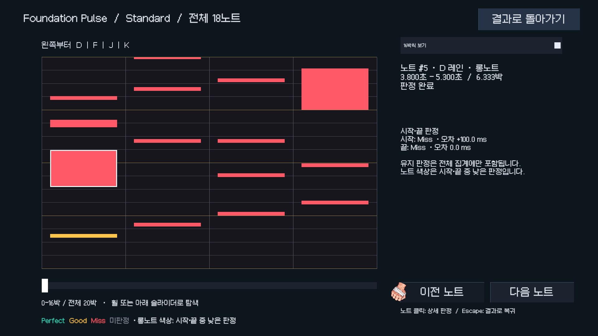
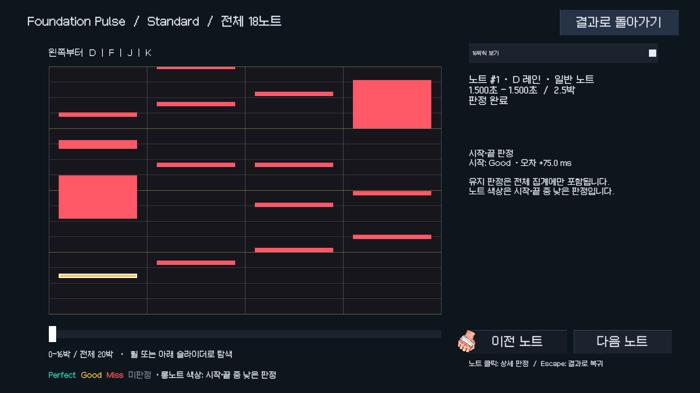
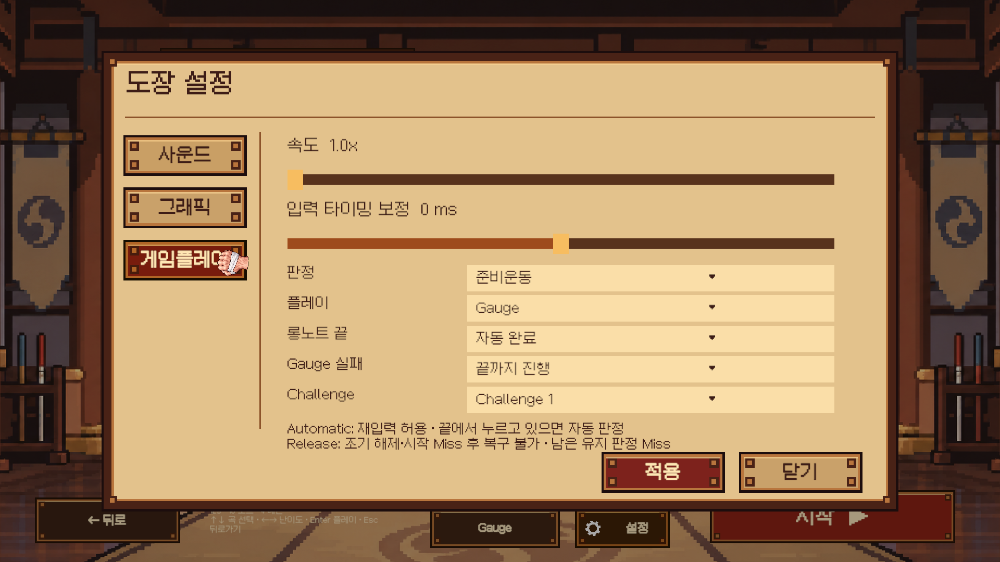

# 동작별 검증 가이드

테스트는 **준비 → 입력/동작 → 관찰 가능한 결과**로 작성합니다. 실패한 테스트 이름만 읽어도 어떤 약속이 깨졌는지 알 수 있어야 합니다. 하나의 긴 플레이 순서에 여러 기능의 성공 여부를 묶지 않습니다.

## 실행

Unity **6000.3.23f1**의 **Game Tools > Verification** 메뉴를 사용합니다.

| 메뉴 | 범위 | 빌드 |
| --- | --- | --- |
| Verify Smoke Actions | 타이틀 진입, 곡 로드, 시작/재시작/포커스, Ready 복귀의 4개 테스트 | 없음 |
| Verify All Tests (No Build) | Domain/EditMode 전체 → PlayMode 전체 | 없음 |
| Verify UI Actions | 타이틀, 곡 선택, 설정, 게임 HUD의 버튼/선택/화면 전환 | 없음 |
| Verify Gameplay Actions | 입력, 판정, 재시작, 포커스, 모드 어댑터, 실제 오디오 | 없음 |
| Verify Authoring Actions | 문서 플레이테스트, 취소, 데이터 캡처, 음원 해제 | 없음 |
| Verify Foundation (Play Mode and Player Build) | Domain/EditMode 전체 → PlayMode 전체 → Windows 빌드 | 테스트 전체 성공 시 |
| Build Player Only | 현재 씬으로 Windows 빌드 | 테스트 생략 |

**Window > General > Test Runner**에서 개별 fixture나 테스트 하나만 선택해도 같은 검증입니다. 메뉴 전용 판정 로직은 없습니다. PlayMode의 `Smoke`, `UI`, `Gameplay`, `Authoring` 카테고리로 범위를 선택할 수 있습니다.

## 변경 범위에 맞춘 실행

파일을 수정할 때마다 전체 테스트를 실행하지 않습니다. 논리적으로 묶인 변경을 마친 뒤 다음 최소 범위를 선택합니다.

| 변경 | 기본 검증 |
| --- | --- |
| 문서·주석 | diff 확인, Unity 테스트 생략 |
| Domain/Application 규칙 | 관련 Domain/EditMode fixture |
| UI 색상·문구·배치 | 관련 레이아웃 검사와 화면 확인. 클릭 영역·참조 변경 시 해당 PlayMode 테스트 추가 |
| 특정 화면·게임 기능 | 해당 fixture 또는 관련 테스트 메서드 |
| 씬 조립·공통 화면 전환 | 관련 테스트 + Smoke |
| 여러 기능의 공통 계약·검증 실행기·패키지 변경, 원인 불명 회귀 | Verify All Tests (No Build) |
| 빌드 설정·플랫폼 변경, 전체 배포 검증 요청 | Foundation 및 Windows 빌드 |

성공 후 관련 코드가 바뀌지 않았으면 동일 검증을 반복하지 않습니다. 실패 시 실패 테스트와 영향을 받는 범위를 먼저 재검증하고, 원인이나 영향이 불명확할 때 확대합니다. 실행 범위·결과·생략 이유를 보고하며 부분 검증을 전체 성공으로 표현하지 않습니다. 빌드는 빌드 관련 변경 또는 명시적 요청 시에만 실행합니다.

개별 fixture는 `unity command run_tests --mode playmode --filter GameplayHudFlowTests --async_tests true --json`처럼 선택합니다. Domain/EditMode는 `--mode editor`를 사용합니다. 소스 변경 후 재컴파일, 순차 실행, `test_status` 결과 확인과 Play Mode 종료 및 Editor ready 대기는 부분 검증에도 적용합니다.

Smoke는 다음 기존 메서드에 추가된 카테고리입니다. 기존 UI/Gameplay 분류와 전체 검증에도 계속 포함됩니다.

| fixture | 메서드 |
| --- | --- |
| MainMenuFlowTests | StartLoadsBootstrapThenExistingSongSelection |
| SongSelectionFlowTests | MouseClickUsesUiInputModuleToLoadSong |
| GameplayFlowTests | KeyboardNavigationAndStartRestartFocusLossUseActualActions |
| GameplayHudFlowTests | ReturnButtonInReadyStateLoadsSongSelectionAndReleasesSong |

Smoke는 곡 전체 재생·판정 시나리오를 포함하지 않으며 기능별 검증을 대체하지 않습니다. 판정·오디오 변경에는 해당 fixture를 별도로 선택합니다. 메뉴는 `FoundationVerification.RunSmoke()`를 실행하고, 빌드 없는 전체 검증은 기존 `RunTestsOnly()`를 실행합니다. 결과는 각각 `Logs/verification-smoke.xml`과 기존 전체 검증 XML에 저장합니다.

## 실행 결과와 정리

검증 시작 시 기존 Play Mode 시작 씬을 보관하고, 검증 중에는 Title 강제 시작을 중단합니다. 테스트가 직접 필요한 씬을 로드하며, 완료/실패 후 이전 시작 씬을 복원합니다. 에디터 자체가 강제 종료되면 정상 종료 시의 복원 절차를 실행할 수 없습니다.

Test Framework 1.6.0의 결과 콜백은 임시 씬/프로젝트 설정 정리보다 먼저 호출됩니다. 실행기는 정리 작업 종료까지 기다린 뒤 다음 테스트, 빌드, 에디터 종료로 진행합니다. 이 버전에 공개된 작업 완료 API가 없어 `FoundationVerification`의 작은 어댑터에서 내부 작업 상태를 읽습니다. Test Framework를 업그레이드할 때 이 어댑터와 임시 씬 정리/시작 씬 복원을 함께 확인하세요.

전체 검증의 XML은 `Logs/verification-editmode.xml`, `Logs/verification-playmode.xml`에 저장됩니다. 부분 검증은 `Logs/verification-ui.xml`, `Logs/verification-gameplay.xml`, `Logs/verification-authoring.xml`을 사용합니다. `Logs/verification.txt`는 마지막 메뉴 실행의 동작별 결과입니다. 실패, 취소, 미실행 또는 0개 실행을 성공으로 간주하지 않습니다.

## 버튼과 동작의 기대 결과

| 구역 | 입력/동작 | 기대 결과 | 테스트 |
| --- | --- | --- | --- |
| Title | 배경 클릭 | Bootstrap을 거쳐 곡 선택, 중복 시작 방지 | MainMenuFlowTests |
| Title | 설정 아이콘 | 현재 사양은 placeholder: 화면 전환/게임 시작 없음 | MainMenuFlowTests |
| Title | 종료 아이콘 | 확인 팝업 표시, 배경 메뉴 잠금 | MainMenuFlowTests |
| Title | 아니요 | 팝업 닫기, 메뉴 다시 활성화 | MainMenuFlowTests |
| Title | 예 | 종료 요청 1회, 게임 시작 없음 | MainMenuFlowTests |
| 곡 선택 | 곡/난이도/스크롤/배속 변경 | 해당 선택 반영, 독립 옵션 유지 | SongSelectionFlowTests |
| 곡 선택 | Play | 선택한 곡과 옵션으로 Gameplay 로드 | SongSelectionFlowTests |
| 곡 선택/설정 | Settings / Back | 설정 진입/복귀, 기존 곡 선택 유지 | SettingsFlowTests |
| 설정 | 버퍼 선택 | 요청값만 변경, 실제 오디오는 그대로 | SettingsFlowTests |
| 설정 | Apply | 실제 DSP 설정과 결과 표시, Default 복원 | SettingsFlowTests |
| Gameplay HUD | Ready/Completed의 Return | 곡 선택으로 복귀, 세션/음원 정리 | GameplayHudFlowTests |
| Gameplay HUD | 플레이 중 | Return 숨김, Escape로 복귀 가능 | GameplayHudFlowTests |
| Gameplay | Space / 재시작 / 포커스 상실 | 재생 시작, 상태 초기화, 눌린 키 재입력 차단, Ready 복귀 | GameplayFlowTests, GameplayJudgmentTests |
| Gameplay | 타임스탬프가 있는 D/F/J/K | 탭/홀드/동시 입력과 180ms 지연에도 13 Perfect / 2 Good / 3 Miss | GameplayJudgmentTests |
| Gameplay | 재시작 후 정확한 입력 / 무입력 | 18 Perfect / 18 Miss 각각 독립 검증 | GameplayJudgmentTests |
| Gameplay | 템포 경계의 홀드 | Constant와 BPM 각각 8 Perfect, 완료 HUD 시간 유지 | GameplayJudgmentTests |
| 오디오 | 각 버퍼 적용 / 재생 / 재시작 | 실제 설정 보고, DSP 진행, 게임 중 변경 거부 | AudioFlowTests |
| 문서 | 플레이테스트/취소/복귀 | 스냅샷과 세션 ID 유지, 음원 해제, 재시도 | AuthoringFlowTests |
| 씬 생성 | 5개 씬 재생성/반복 생성 | Title 포함 참조 유효, GUID 및 콘텐츠 보존 | SceneRegenerationTests, ContentTests |

종료 테스트는 가짜 `IMainMenuActions`를 사용해 종료 요청까지 검증합니다. 실제 프로세스를 종료하면 Test Runner도 중단되므로 OS 프로세스 종료 자체를 자동 검증했다고 해석하지 않습니다. 타이틀 설정 버튼에 기능이 추가되면 placeholder 테스트의 기대 결과도 함께 바꿉니다.

버튼 경로는 가능한 한 가상 마우스 입력으로 uGUI/Input System을 통과시킵니다. 공통 클릭 도우미는 버튼이 활성화되어 있고 다른 UI에 가려지지 않았는지도 확인합니다. 드롭다운 값 변경 테스트는 선택 콜백과 결과를 확인하며, 별도 키보드 테스트가 실제 선택 UI 경로를 확인합니다. 서비스 메서드를 직접 호출한 테스트만으로 버튼 연결까지 검증했다고 하지 않습니다.

## 팀원이 기능을 추가할 때

1. 버튼/키/상태 변화의 기대 결과를 먼저 한 문장으로 정합니다.
2. UI는 해당 화면 fixture에, 판정/입력은 Gameplay에, 문서 기능은 Authoring에 독립 테스트를 추가합니다.
3. 입력 전 상태를 만들고 실제 동작을 수행한 뒤 화면, 서비스 상태, 해제된 리소스 등 결과를 검사합니다.
4. 비동기 대기에는 시간 제한을 두고, 실패해도 입력 장치/오디오/이벤트 구독을 정리합니다.
5. 관련 fixture를 먼저 실행합니다. 공통 흐름이나 씬 조립 변경에는 Smoke를 추가하고, 위 표의 위험도에 따라 전체 테스트나 빌드로 확대합니다.

레이아웃은 빌더에 반영합니다. 테스트도 UI 객체 이름보다 View의 명시적 참조를 우선합니다. 기존 판정 수치는 검증용 차트의 계약이므로 검증용 차트를 의도적으로 바꾸면 함께 검토해야 합니다.

## 배치 실행

해당 프로젝트를 연 Unity를 닫고 저장소 루트 PowerShell에서 실행합니다. 각 프로세스가 종료될 때까지 기다리고 `-quit`는 붙이지 않습니다.

```powershell
$unity = 'C:/Program Files/Unity/Hub/Editor/6000.3.23f1/Editor/Unity.exe'
& $unity -batchmode -projectPath "$PWD" -runTests -testPlatform PlayMode -testCategory UI -testResults "$PWD/Logs/ui.xml" -logFile "$PWD/Logs/ui.log"
# Gameplay 또는 Authoring도 같은 방법으로 선택합니다.
& $unity -batchmode -projectPath "$PWD" -executeMethod RhythmDojo.EditorTools.FoundationVerification.RunAll -logFile "$PWD/Logs/foundation.log"
```

오디오 테스트는 출력 장치에 의존합니다. 실제 DSP 설정/시간 진행을 검사하며 사람이 느끼는 입력 지연이나 잡음이 없음을 보증하지 않습니다. 스크린샷은 `Logs/`에 남는 보조 자료이고 자동 시각 비교는 아닙니다.

## 결과 기록과 롱노트 규칙 v3

`PlayRules.CurrentVersion`은 3이다. Automatic은 시작 Miss나 중간 해제 후에도 재입력할 수 있고, 끝 시각의 키 상태로 자동 끝 판정을 적용한다. Release는 조기 해제 순간 끝 Miss와 HP·콤보·실패를 한 번 적용하며 재입력으로 복구하지 않는다. 남은 유지 시각에는 키 상태와 무관하게 Miss를 적용한다. Release의 시작 Miss도 복구할 수 없다. 정상/늦은 해제는 기존 판정창과 시간 허용 오차를 사용한다.

최고 기록 키에는 규칙 버전이 포함되므로 v2 기록을 삭제하거나 변환하지 않는다. Automatic을 포함한 모든 v3 기록은 이전 버전과 분리된다. enum 값과 저장 필드 이름은 유지한다.

세션은 노트 수만큼 `NoteJudgmentRecord` 배열을 할당하고 시작·끝 확정 시 해당 슬롯만 갱신한다. Reset은 같은 배열을 비운다. 유지 판정은 HP·콤보·정확도와 상단 집계에 계속 포함되지만 상세 기록에는 포함되지 않는다. 아직 도달하지 않은 시작·끝은 null이며 Miss와 구분한다. 구형 세션 경로는 기존 한 노트당 최종 점수 규칙을 유지하면서 성공한 홀드 시작과 최종 판정을 각각 기록한다.

실제 종료 경로의 `PlayResult`는 노트 배열을 직접 채운다. 노트별 임시 리스트·판정 배열·읽기 전용 래퍼를 만들지 않으며 `PlayNoteResult.Judgments`는 같은 객체의 최대 두 값 뷰다. 기존 전체 이벤트 생성자는 호환용으로 기존 복사/집계 동작을 유지한다. 새 결과는 세션 초기화 후에도 바뀌지 않는다. 상세 대표 색은 시작·끝 중 낮은 판정만 반영하므로 유지 Miss가 상단에 있어도 상세가 Perfect일 수 있다.

Results는 `ScreenCompositionRoot`가 결과와 복귀 Action을 주입한다. 직접 Results를 실행하면 빈 결과를 표시하고 곡 선택으로 돌아간다. 에디터 테스트 플레이는 기존 AppFlow의 반환 경로를 사용한다. 레이아웃은 Build Results와 Build Settings로 재생성하며 SettingsPopup도 함께 갱신한다.

검증 fixture: `PlayRulesTests`, `RhythmSessionTests`, `PlayResultReviewTests`, `ResultsLayoutTests`, `ResultsFlowTests`, `PupaResultsFlowTests`, `SettingsFlowTests`. `FixedRecordSlotUpdatesAllocateNoManagedMemory`는 초기화 이후 고정 결과 슬롯 20만 회 갱신만 측정한다. 전체 게임플레이(입력 이력 등), 결과 객체 생성 또는 열거가 무할당이라는 의미는 아니다.

### 2026-10-29 실행 결과

Unity 6000.3.23f1에서 갱신·컴파일 후 순차 실행했다. 선택 검증은 PlayRulesTests 23/23, RhythmSessionTests 23/23, PlayResultReviewTests 4/4 통과했다. ResultsFlowTests 필터는 PupaResultsFlowTests도 포함하여 14개 중 13개 통과, 실제 PUPA 재생 1개는 FocusLost로 실패했다. 해당 1개 단독 재실행도 FocusLost와 FMOD 출력 장치 초기화 오류로 실패했다.

최종 **Verify All Tests (No Build)**는 EditMode 219 통과·0 실패, PlayMode 102 통과·8 실패, 건너뜀 0개다. 전체 통과가 아니다. ResultsFlowTests 8개와 시작·끝 고정 기록/스냅샷 테스트는 통과했다. 슬롯 20만 회 갱신의 managed allocation은 0바이트였다. 실제 종료 생성자의 소스 검토에서도 노트별 임시 리스트·판정 배열·래퍼가 없는 것을 확인했다. Windows 빌드는 요청 범위에 따라 생략했다.

전체 PlayMode 실패 목록:

- `RhythmDojo.Tests.AudioFlowTests.AllBufferRequestsReportActualConfigurationAndChangedAudioPlaysAndRestarts`: Apply during transition must be rejected.   Expected: False   But was:  True
- `RhythmDojo.Tests.ChartEditorMenuTests.PupaButtonPreservesDraftAndImportsBundledChartWithLocalAudio`: Expected: 0   But was:  -0.02d
- `RhythmDojo.Tests.DojoClickFeedbackTests.BurstUsesBoundedObjectsAndRipplesExpireWhilePaused`: TearDown : Unhandled log message: '[Error] FMOD failed to initialize the output device.: "Error initializing output device. " (60)'. Use UnityEngine.TestTools.LogAssert.Expect
- `RhythmDojo.Tests.GameplayHudFlowTests.GameplayKeepsDisplayCameraWhileWorldRendersIntoWindow`: TearDown : Unhandled log message: '[Error] FMOD failed to initialize the output device.: "Error initializing output device. " (60)'. Use UnityEngine.TestTools.LogAssert.Expect
- `RhythmDojo.Tests.PixelDojoCursorTests.NativeCursorUsesPressedArtworkOnlyWhileLeftButtonIsHeld`: TearDown : Unhandled log message: '[Error] FMOD failed to initialize the output device.: "Error initializing output device. " (60)'. Use UnityEngine.TestTools.LogAssert.Expect
- `RhythmDojo.Tests.PupaResultsFlowTests.RealPupaAudioFinishesAndAutomaticallyLoadsResults`: PUPA playback was reset before completion: FocusLost TearDown : Unhandled log message: '[Error] FMOD failed to get driver capabilities ... : "Error initializing output device. " (60)'. Use UnityEngine.TestTools.LogAssert.Expect
- `RhythmDojo.Tests.SettingsFlowTests.SettingsPopupTabsSaveAudioAndApplySeparateGraphicsControls`: TearDown : Unhandled log message: '[Error] FMOD failed to initialize the output device.: "Error initializing output device. " (60)'. Use UnityEngine.TestTools.LogAssert.Expect
- `RhythmDojo.Tests.SongSelectionFlowTests.SongRowsKeyboardSelectionUpdatesSelectedSong`: Expected string length 11 but was 36. Strings differ at index 0.   Expected: "tempo-pulse"   But was:  "0349e961-3846-4eb0-bf80-63209e44e6e4"   -----------^

`SettingsPopupTabsSaveAudioAndApplySeparateGraphicsControls`는 전체 실행 후 단독 재실행에서 1/1 통과했다. 전체 실행의 실패 집계는 그대로 보존한다.

위 실패를 숨기거나 오디오 오류를 무시하도록 테스트/런타임을 변경하지 않았다. 전체 XML과 상세 실행 기록은 로컬 `Logs/verification-editmode.xml`, `Logs/verification-playmode.xml`, `Logs/verification.txt`에 있다. 결과 상세와 설정 화면은 1920×1080 렌더링을 직접 확인했다.






