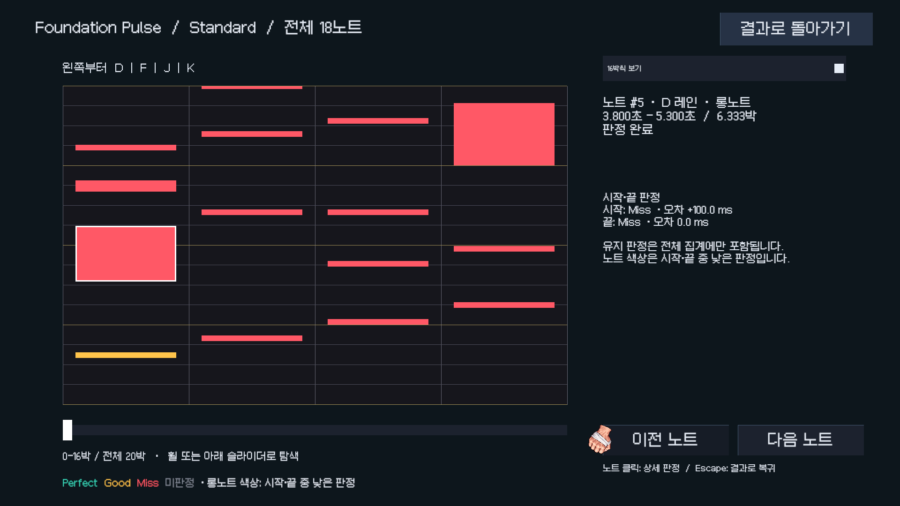
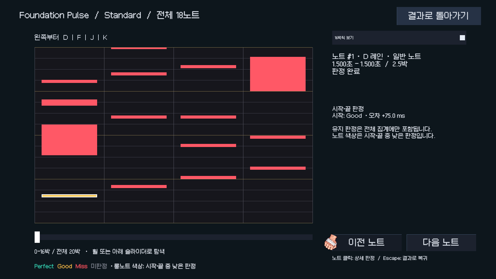
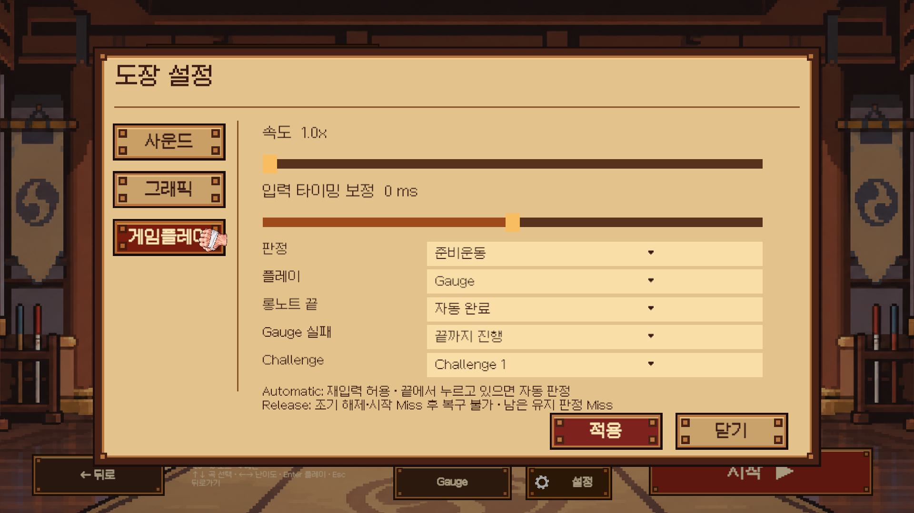

# 동작별 검증 가이드

## 실행 프로필

Unity **6000.3.23f1**, Unity Test Framework **1.6.0**을 사용한다. `FoundationVerification`은 메뉴와 CLI에서 같은 선택기를 사용한다. 기능 태그와 비용 태그의 조건은 교집합이며, 모든 검사에는 비용 태그 하나를 지정한다. `Compatibility`는 비용과 별개인 구형 API·저장 형식 호환성 태그다.

| 프로필 | 메뉴 | 선택 범위 |
| --- | --- | --- |
| All | Verify All Tests (No Build) | Domain/EditMode와 PlayMode 전체, 모든 비용 분류 |
| Fast | Verify Fast Tests | 시간 경과·장치 변경·에셋 생성을 요구하지 않는 검사 |
| UI / Gameplay / Authoring | Verify UI / Gameplay / Authoring Actions | 해당 기능 ∩ (Fast ∪ SceneIntegration) |
| Smoke | Verify Smoke Actions | 기존 화면 이동·입력·정리 4개 검사 |
| SceneIntegration | CLI 프로필 | 씬 구성·입력·수명 통합 검사 |
| AssetGeneration | Verify Asset Generation | 실제 씬·프리팹·이미지·설정 에셋 생성 및 복원 |
| Hardware | Verify Hardware | 실제 버퍼·복구·반복 재개·FPS·해상도·오디오 관측 |
| Endurance | Verify Endurance | 전체 곡 재생과 장시간 누적 시각 |
| HealthPlaytest | Playtest Health and Results | 체력·결과 기능 ∩ (Fast ∪ SceneIntegration) |

Foundation의 기존 `RunAll()`은 All 이후 Windows 플레이어를 빌드한다. `RunTestsOnly()`는 빌드 없이 All을 실행한다. 기존 메뉴 메서드 이름은 유지한다. `Build Player Only`는 검사를 생략하고 현재 씬을 빌드한다.

프로필 선택기는 실제 Test Runner 목록의 leaf를 검사하여 미분류·복수 비용·중복 이름을 거부한다. 기능 카테고리를 CLI `-testCategory UI`에 직접 전달하면 비용 교집합을 적용하지 못하므로, 일반 기능 실행에는 아래 공통 프로필 명령을 사용한다.

## 변경별 실행 범위

| 변경 | 기본 검증 |
| --- | --- |
| 문서·주석 | diff 확인 |
| Domain/Application 규칙 | 관련 Domain/EditMode fixture·사례 |
| UI 색상·문구·배치 | 관련 레이아웃 검사와 화면 확인; 클릭 영역·필수 참조 변경 시 해당 PlayMode |
| 특정 화면·기능 | 해당 fixture·사례 |
| 씬 구성·공통 화면 이동 | 관련 검사 + Smoke |
| 오디오 설정·복구 | 관련 검사 + 해당 Hardware |
| 예약 재생·곡 종료·장시간 시각 누적 | 관련 검사 + 해당 Endurance |
| 여러 계층의 영향이 불명확한 변경·검증 실행기·패키지 계약 | All, 빌드 없음 |
| 빌드 설정·플랫폼 또는 명시적 빌드 요청 | 관련 검사 + Windows 빌드 |

파일 수만으로 전체 실행을 결정하지 않는다. 통과 범위는 관련 변경이나 새로운 실패 근거가 없으면 반복하지 않는다. 실패 후에는 실패 사례와 영향 범위를 먼저 재검증한다. 단순 UI 변경에는 Hardware·Endurance를 자동 추가하지 않는다.

Smoke는 다음 기존 사례를 선택하며, 기능별 검증을 대체하지 않는다.

| fixture | 메서드 |
| --- | --- |
| MainMenuFlowTests | StartLoadsBootstrapThenExistingSongSelection |
| SongSelectionFlowTests | MouseClickUsesUiInputModuleToLoadSong |
| GameplayFlowTests | KeyboardNavigationAndStartRestartFocusLossUseActualActions |
| GameplayHudFlowTests | ReturnButtonInReadyStateLoadsSongSelectionAndReleasesSong |

## 명령과 실행 순서

실행 중인 Editor에서는 Pipeline을 사용한다. 소스 변경 후 재컴파일을 완료하고 검사를 순차 실행한다.

```powershell
unity status --json
unity command run_tests --mode playmode --filter SelectionBrowserTests --async_tests true --json
unity command test_status --json
```

Domain/EditMode의 mode는 `editor`다. `test_status` 결과를 확인한 뒤 Play Mode 종료와 `unity status --json`의 ready를 확인하고 다음 실행을 시작한다. 공통 프로필은 Editor 메뉴 또는 Pipeline의 `run_script`에서 `FoundationVerification.RunUi()` 등의 기존 메서드를 호출한다. 이 실행의 완료 근거는 `Logs/verification.txt`와 XML이다.

`ready`는 디스크의 최신 C#이 컴파일됐다는 보장이 아니다. 소스 변경 후 `unity command recompile --focus true --json`을 실행하고 `unity command recompile_status --json`의 완료·오류 없음 및 실제 대상 테스트 검색/실행 건수를 확인한다. 도메인 재로드 동안 연결이 잠시 끊기면 복구를 기다린다. 0건 결과는 통과가 아니다. `run_script`가 반환됐다는 사실만으로 예약한 `delayCall`의 실행이나 씬 생성 완료를 판정하지 않는다. 생성 완료 기록과 저장된 씬의 참조까지 확인한다.

배치에서는 해당 프로젝트의 Editor를 닫고 저장소 루트 PowerShell에서 실행한다. 프로세스 종료를 기다리고 비동기 검사에 `-quit`를 붙이지 않는다.

```powershell
$unity = 'C:/Program Files/Unity/Hub/Editor/6000.3.23f1/Editor/Unity.exe'
& $unity -batchmode -projectPath "$PWD" -executeMethod RhythmDojo.EditorTools.FoundationVerification.RunProfile -verificationProfile UI -logFile "$PWD/Logs/ui.log"
& $unity -batchmode -projectPath "$PWD" -executeMethod RhythmDojo.EditorTools.FoundationVerification.RunTestsOnly -logFile "$PWD/Logs/all.log"
# 관련 사례만 실행하는 경우
& $unity -batchmode -projectPath "$PWD" -runTests -testPlatform EditMode -testFilter RhythmDojo.Tests.CoordinatorTests -testResults "$PWD/Logs/coordinator.xml" -logFile "$PWD/Logs/coordinator.log"
```

실제 장치 검사는 출력 장치가 사용 가능한 Windows 세션에서 실행한다. 배치 세션에 장치가 없으면 실패 원인을 기록하고 연결된 데스크톱 Editor에서 해당 범위를 재검증한다. 장치 실패를 무시하거나 skip으로 바꾸지 않는다.

## 준비·복원과 결과

공통 PlayMode 정리는 초기 오디오 설정과 설정 변경 이벤트를 추적한다. 설정과 이벤트에 변화가 없으면 `AudioSettings.Reset`을 생략한다. 설정값이 같아도 장치 재설정 이벤트가 발생한 검사는 원래 설정으로 복구한다. 입력 장치·PlayerPrefs·이벤트 구독·소유 객체 복원은 유지한다. Workspace 종료는 별도의 빈 씬을 사용한다.

`NativeInputScope`는 입력 설정을 바꾸기 전에 생성한다. 정상 정리 외에도 Editor의 Play Mode 종료와 도메인 재로드에서 테스트가 끈 물리 장치를 복원하고, scope 안에서 추가된 가상 장치를 제거한다. 재로드 전후의 입력 상태 직렬화 순서 차이는 SessionState 복원 기록으로 처리한다. 원래 비활성이던 장치와 scope 이전 장치는 보존한다. 실제 사용자 입력 회귀를 확인할 때는 테스트 종료 후 Game View에 초점을 둔 상태에서 native Keyboard/Mouse 활성 여부와 가상 장치 잔존 여부도 확인한다.

씬 전체 생성은 한 시나리오에서 두 번 실행한다. 첫 번째는 씬 파일 삭제 후 GUID 보존과 복구, 두 번째는 반복 생성 안정성을 확인한다. 9개 씬의 필수 참조·직렬화된 구성, 생성 프리팹·이미지, 설정·음원·재질 불변 및 Build Settings를 검사한다. 파일·meta·Editor 상태의 스냅샷은 성공과 예외 모두에서 복원하며 새로 생성한 파일을 정리한다. 참조 누락은 독립 View·프리팹 복제본에서, 마이그레이션 분기는 메모리 객체에서 검사한다. 실제 생성·보존 경로는 AssetGeneration에 남긴다.

`Title`은 닫힌 대문과 진입·복귀 연출을, `ModeSelection`은 기존 모드 선택 UI와 캐릭터·상호작용을 소유한다. 문이 열리는 동안에는 `ModeSelection`의 실제 방을 입력이 차단된 additive 씬으로 표시하고, 문 열림이 끝나면 활성 씬과 카메라·입력·음악 재생을 넘긴 뒤 `Title`을 해제한다. Esc 또는 게임패드 뒤로 가기는 `Title`의 문 닫힘 연출을 거쳐 모드 씬을 해제한다. 곡 선택의 사전 준비는 활성화된 `ModeSelection`에서 시작한다.

두 씬은 Project 창에서 각각 열 수 있다. `Build Title`, `Build Mode Selection`, `Build Tutorial`, `Build All Scenes`가 각 구성을 재생성하며 디자인 수정은 기존 레이아웃 빌더에 반영한다. `ModeSelection`에서 바로 Play Mode를 확인하려면 기존 **Start Play Mode From Title** 옵션을 끈다. 씬 분리 검증은 `MainMenuTests`, `MainMenuFlowTests`, `ScenePreparationFlowTests`와 Smoke를 사용한다.

### 제품 씬과 직접 실행 경로

Build Settings의 순서는 `Title`, `ModeSelection`, `Bootstrap`, `SongSelection`, `Gameplay`, `Settings`, `Results`, `ChartEditor`, `Tutorial`이다. 별도 활성 Build Profile이 씬 목록을 덮어쓰는지도 확인한다. 이름만으로 판단하지 않고 `MainMenuActions`, `MainMenuEntranceScreen`, `AppFlowController`, `PreparedSelectionScene`의 실제 호출과 각 composition root의 참조를 추적한다.

| 씬/화면 | 현재 소유 구성과 실행 경로 |
| --- | --- |
| Title | `MainMenuEntranceScreen`과 한옥 대문. 입장 시 ModeSelection을 additive로 로드하고 입력·카메라·음악 소유권을 넘긴 뒤 Title을 해제한다. |
| ModeSelection | `MainMenuScreen`/`DojoModeView`가 네 방을 소유한다. `AlphaDojoLayoutBuilder`가 최신 배경·인물·타이포그래피를 조립한다. |
| 비급 전수 | 첫 번째 방의 제목 클릭 또는 시작 입력으로 `Tutorial` 씬에 바로 진입한다. 메뉴의 4박자 맞히기는 제거했다. `TutorialLayoutBuilder`의 `Story Stage`가 향후 스토리를 담는 영역이며, 복귀 버튼·Esc는 ModeSelection으로 돌아간다. |
| 자유 연습 | 두 번째 방 → SongSelection의 `PracticeSelectionView`/목인. 준비 중인 씬도 활성화 직전에 최종 선택 상태를 다시 적용한다. |
| 실력 검정 | 세 번째 방 → 같은 SongSelection의 목인 화면, Challenge 규칙. 제목과 기록은 규칙에서 결정하며 ‘곡 목록’은 두 모드의 공통 보조 패널이다. |
| 율보 편찬 | 네 번째 방 → ChartEditor. `ChartEditorSceneBuilder.Build()`는 `WorkspaceSceneBuilder.Build()`로 연결되어 확장 편집 UI를 생성한다. |
| Bootstrap / SongSelection 직접 실행 | 새 AppFlow의 기본 진입은 자유 연습 목인 화면. 기존 AppFlow가 있으면 선택한 모드와 규칙을 보존한다. Bootstrap은 단축 초기화 경로이며 전체 메뉴 확인은 Title에서 시작한다. |
| Gameplay | AppFlow의 선택 곡을 사용하며 직접 실행 시 기본 카탈로그 곡을 준비한다. 종료/결과 복귀 시 규칙·곡·난이도를 유지한 목인 화면으로 돌아가며 목록 패널은 닫는다. |
| Settings / Results | 직접 실행 가능한 현행 씬. 일반 설정은 같은 빌더가 생성한 `Resources/UI/SettingsPopup.prefab`을 재사용한다. 결과 없는 Results 직접 실행은 빈 결과 표시이며 실제 결과/재시도는 플레이 경로에서 확인한다. |

`SongSelectionView.Validate()`는 목인 구성을 필수로 검사한다. 오래된 씬에서 참조가 없을 때 목록으로 조용히 대체하지 않는다. `GameplayTestContext`와 모든 fixture는 제품 기본 목인 화면을 그대로 사용한다. 목록 검사는 실제 곡 목록 버튼으로 패널을 연다. 정렬·필터·빈 결과와 표시 상태는 `SelectionPreferencesTests`에서 화면 없이도 검증한다. `MainMenuFlowTests`는 Title 입장, 네 방의 기능, 직접 진입, 사전 준비/해제와 중복 입력 소유권을 검증한다. Bootstrap의 view 없는 API 진입은 `Compatibility`로 식별한다.

`Assets/Scenes/SampleScene.unity`와 로컬 무시 폴더의 `Assets/CodexIdeRepairTemp/MainMenuTestHost.unity`는 제품 빌드 및 현행 테스트의 진입 대상이 아니다. `Logs` 아래의 과거 씬·프로젝트 복사본과 기존 EXE는 현재 실행 증거로 사용하지 않는다. 삭제하거나 최신 제품 씬 위에 복사하지 않는다.

Test Framework 1.6.0의 결과 callback은 씬·설정 정리보다 먼저 발생한다. 실행기는 내부 작업 상태를 확인하여 정리 종료 후 다음 mode·빌드·Editor 종료로 진행한다. 패키지 버전 변경 시 이 어댑터와 시작 씬 복원도 검증한다.

`Logs/verification.txt`에는 프로필·고유 사례 수·결과·소요 시간과 실패 상세만 기록한다. All XML은 `verification-editmode.xml`, `verification-playmode.xml`이며, 부분 프로필은 `verification-ui-editmode.xml`과 같이 프로필·mode를 포함한다. 각 XML에 개별 결과와 시간이 남는다. 특정 mode에 해당 사례가 없으면 실행하지 않고 기록하며, 프로필 전체 0개·skip·inconclusive·실패는 성공이 아니다.

보고는 변경 결과와 사용자 영향을 먼저 설명하고, 검증은 기본 한 문단으로 범위·결과·필요한 제한을 요약한다. 성공한 메서드명과 숫자의 장황한 나열은 생략한다. 실패·미해결 사항·요청된 감사만 상세 목록으로 제공한다. 부분 실행과 후속 재검증을 합친 결과는 단일 전체 통과로 표현하지 않는다.

시간 비교에서는 같은 검증 범위의 준비·실행 비용 변화와 느린 검사를 제외한 기본 프로필의 감소를 구분한다. 실행 환경과 범위가 다르면 비교 한계를 함께 기록한다. 기존 감사의 판정 이관·호환성·통합 대응은 [검사 개편 대응표](test-verification-migration.csv)에서 확인한다.

## 테스트 추가와 검증 기준

테스트는 준비 → 입력·동작 → 관찰 가능한 결과의 순서로 작성한다. 각 사례는 확인할 계약을 명확히 하고 서로 무관한 성공 조건을 하나의 긴 플레이 순서로 묶지 않는다. 새로운 사용자 동작, 실제 회귀, 기존 검사가 놓치는 경계를 검증할 때만 추가한다. 먼저 기존 사례의 확장·대체를 검토한다. 단순 값 대입·이름·구조 확인이나 구현을 반복하는 검사는 늘리지 않는다. 빠른 판정 경계와 오프셋 조합은 유지한다.

UI는 View의 필수 참조, 공유 자원 소유권, 클릭 영역·겹침·텍스트 넘침을 확인한다. 명시된 디자인 계약의 크기·순서는 유지한다. 버튼 검사는 가상 입력과 raycast를 통과시키며, 서비스 직접 호출을 실제 클릭 검증으로 보고하지 않는다. 비동기 준비는 완료 조건과 제한시간·실패 원인을 갖추고, 오디오 관측 구간과 연출 지속시간의 검증 대기는 유지한다.

## 현재 동작 계약

타이틀 진입 영역을 누르면 대문 연출을 거쳐 ModeSelection으로 이동한다. 각 방의 시작 버튼은 위 표의 비급 전수·자유 연습·실력 검정·율보 편찬 경로를 사용한다. 설정은 재사용 팝업을 열며, 종료는 확인 팝업에서 요청을 한 번 전달한다. 실제 프로세스 종료 자체는 자동 검사 범위가 아니다. Gameplay의 Escape는 일시정지와 재개 경로이며, 종료·결과 이동은 AppFlow가 세션과 음원 소유권을 정리한다. 상세 UI 계약은 [타이틀 안내](pixel-dojo-title.md), [팀 경계](team-ownership.md)를 따른다.

버퍼 적용은 DSP 시계 진행률을 검사한다. 실시간 관측 길이 T, DSP 증가량 D, 실제 블록 크기 B, 샘플레이트 F에 대해 E = 2B/F로 두 끝점의 오차를 반영한다. 진행률 구간 전체가 [0.99, 1.01]에 포함되는 독립 관측 두 번만 정상으로 인정한다. 관측·복구의 전체 제한시간은 20초이며, 시간 만료나 복원 요청 수락은 정상 판정이 아니다. `ClockRateMeasurements`와 `Logs/audio-buffers.txt`가 근거다. 이는 체감 지연이나 출력 품질 측정과는 범위가 다르다.

## 결과 기록과 롱노트 규칙 v4

`PlayRules.CurrentVersion`은 4이다. 입력과 Tick은 모두 `GameplayTiming`의 논리 시각(곡 시각 − 입력 보정값)을 사용한다. 시작·유지·자동 끝·해제 판정에 같은 기준을 적용하며 Presenter는 표시용 곡 시간을 사용한다. Automatic은 시작 Miss나 중간 해제 후에도 재입력할 수 있고, 끝 시각의 키 상태로 자동 끝 판정을 적용한다. Release는 조기 해제 순간 끝 Miss와 HP·콤보·실패를 한 번 적용하며 재입력으로 복구하지 않는다. 남은 유지 시각에는 키 상태와 무관하게 Miss를 적용한다. Release의 시작 Miss도 복구할 수 없다. 정상/늦은 해제는 기존 판정창과 시간 허용 오차를 사용한다.

최고 기록 키에는 규칙 버전이 포함되므로 v2·v3 기록을 삭제하거나 변환하지 않는다. Automatic을 포함한 모든 v4 기록은 이전 버전과 분리된다. enum 값과 저장 필드 이름은 유지한다.

세션은 노트 수만큼 `NoteJudgmentRecord` 배열을 할당하고 시작·끝 확정 시 해당 슬롯만 갱신한다. Reset은 같은 배열을 비운다. 유지 판정은 HP·콤보·정확도와 상단 집계에 계속 포함되지만 상세 기록에는 포함되지 않는다. 아직 도달하지 않은 시작·끝은 null이며 Miss와 구분한다. 구형 세션 경로는 기존 한 노트당 최종 점수 규칙을 유지하면서 성공한 홀드 시작과 최종 판정을 각각 기록한다.

실제 종료 경로의 `PlayResult`는 노트 배열을 직접 채운다. 노트별 임시 리스트·판정 배열·읽기 전용 래퍼를 만들지 않으며 `PlayNoteResult.Judgments`는 같은 객체의 최대 두 값 뷰다. 기존 전체 이벤트 생성자는 호환용으로 기존 복사/집계 동작을 유지한다. 새 결과는 세션 초기화 후에도 바뀌지 않는다. 상세 대표 색은 시작·끝 중 낮은 판정만 반영하므로 유지 Miss가 상단에 있어도 상세가 Perfect일 수 있다.

Results는 `ScreenCompositionRoot`가 결과와 복귀 Action을 주입한다. 직접 Results를 실행하면 빈 결과를 표시하고 곡 선택으로 돌아간다. 에디터 테스트 플레이는 기존 AppFlow의 반환 경로를 사용한다. 레이아웃은 Build Results와 Build Settings로 재생성하며 SettingsPopup도 함께 갱신한다.

검증 fixture: `PlayRulesTests`, `RhythmSessionTests`, `PlayResultReviewTests`, `ResultsLayoutTests`, `ResultsFlowTests`, `PupaResultsFlowTests`, `SettingsFlowTests`. 실제 판정의 시작·끝 기록과 세션 초기화 후 결과 스냅샷 보존을 검증한다. 고정 결과 슬롯 대입만 반복하는 할당 측정은 검증 범위에서 제외한다.

## 플레이 없이 결과 UI 미리보기

Edit Mode에서 **Game Tools > Preview > Results**를 누르면 샘플 결과가 있는 Results 씬으로 바로 Play Mode를 시작한다. 실제 곡을 플레이하거나 Title 시작 옵션을 끌 필요가 없다. 더보기와 노트 선택을 그대로 사용할 수 있으며 Perfect/Good/Miss, 유지 Miss가 있는 롱노트를 포함한다. **Results (Game Over)**는 Release 조기 해제로 실패하고 이후 노트가 미판정인 예시다.

미리보기는 에디터 전용 샘플을 화면에만 주입하므로 최고 기록이나 마지막 실제 플레이 결과를 저장하지 않는다. Play Mode를 종료하면 원래 작업 씬과 Play Mode 시작 씬 설정으로 돌아온다. 미리보기 메뉴는 Play Mode와 전체 검증 실행 중에는 비활성화된다.

### 외부 WAV 회귀 fixture

`PupaResultsFlowTests`의 기존 이름과 `LocalAudio` 분류는 호출 경로 호환을 위해 유지한다. 외부 음원을 사용하는 세 테스트는 이제 개인 `LocalAudio/PUPA.wav` 대신 임시 44.1kHz mono PCM WAV를 생성하고 실제 외부 음원 로더로 읽는다. 파일 길이는 131.54초, 첫 신호는 채보와 독립적으로 지정한 0.5033333333333334초다. 번들된 929노트 채보에 대해 첫 공격음·입력 시각, 전체 재생 완료, 긴 음원 꼬리 이전 결과 전환을 검사한다. 이것은 실제 PUPA 음원에 대한 검증이 아니다. 테스트가 끝나거나 실패하면 lease와 임시 파일을 해제한다.

### Windows remediation diagnostic

`RhythmDojo.EditorTools.RemediationPlayerVerification.BuildPlayer()` builds the separate development player at `Builds/RemediationProbe/RemediationProbe.exe`. After compilation and Test Runner cleanup, call this method synchronously from a `run_script` entry point with a sufficient timeout (for example `--timeout_ms 600000 --timeout 610`). A short synchronous `eval` can time out and inject an error into a strict build; a callback registered by a temporary script is not proof that the build ran. Confirm the build report and output timestamp. The builder writes `Logs/pr-quality-remediation/player-probe-build.json` and restores the prior scene setup. It includes all product scenes and test assemblies only in this diagnostic build; Foundation still builds the ordinary player separately. The diagnostic visits all four rooms through their visible controls, opens the practice library explicitly, and returns through ModeSelection before Title.

Run the phases sequentially, waiting for each process to exit. Use the same absolute evidence directory for both launches:

```powershell
$probe = (Join-Path $PWD 'Builds/RemediationProbe/RemediationProbe.exe')
$evidence = (Join-Path $PWD 'Logs/pr-quality-remediation/player')
Start-Process -FilePath $probe -WindowStyle Hidden -Wait -ArgumentList @('-remediationPhase', 'exercise', '-remediationOutput', $evidence, '-logFile', "$evidence/exercise-player.log")
Start-Process -FilePath $probe -WindowStyle Hidden -Wait -ArgumentList @('-remediationPhase', 'persistence', '-remediationOutput', $evidence, '-logFile', "$evidence/persistence-player.log")
```

Check each process exit code and the corresponding JSON `success`; a completed process alone does not imply success. The first phase backs up the six known string preference keys, including their existence flags, before isolating them. Successful exercise leaves the two mode key overrides for the next process. Persistence verifies those overrides and their settings UI, then restores the exact original values. Failure also attempts restoration independently of other cleanup. If a process is killed, run the same command with `-remediationPhase restore`; do not remove `preferences-backup.json` before restoration. Backup writes replace the prior file atomically.

The probe uses queued keyboard/mouse input and verifies pointer raycasts before clicking buttons. Menu references come from the active scene's composition root, and reentry waits for the door return animation to finish. Buffer selection uses the Dropdown's normal value-change route, followed by an actual Apply click in the graphics tab. It covers title/settings/editor/selection navigation, editing a new GUID project's title before File > Exit > Save and Exit, mode isolation and HUD/Results labels, external WAV loading, pause/buffer validation/recovery/resume/restart/exit, and the built Results scene. It removes only the probe's new `project.rdchart.json`, `workspace.json` and empty GUID directory, after checking containment, absence before creation, and lack of links or unexpected contents; it never removes existing projects. The owned GUID is saved in the backup for crash cleanup.

`exercise.json` records requested/applied buffers, DSP rate intervals, decoded and mixer sample peaks, and audio/song alignment with DSP block plus observed-frame uncertainty. A `loopback-ready` step holds the recovered external 440 Hz tone for 20 seconds so a separate OS loopback recorder can verify output beyond Unity's mixer. PNGs are offscreen renders using the active pipeline StandardRequest, preserving original display-camera world visibility and the existing gameplay texture. They are not framebuffer captures. Blank frames fail the diagnostic and saved images still require visual review. The Results navigation check explicitly advances the session; it does not substitute for the full real-time external WAV test. Synthetic input, screenshots, and mixer sampling do not by themselves establish physical audio latency or subjective output quality.

## 과거 실행 기록

아래 결과는 해당 시점의 소스와 환경에 대한 기록이다. 현행 실행 범위와 절차는 위 지침을 따른다.

### 2026-11-03 Unity error follow-up

The remaining scene-ownership, input/focus-isolation and rendering verification issues were corrected. Final Domain/EditMode: 399/399 passed. Latest PlayMode results by unique test: 202/202 passed, with no skips. The PlayMode total combines the full 202-test run (197 passed, 5 failed) with passing affected-fixture reruns (resume 9/9, chart editor 4/4, timeline 3/3, title 19/19); it is not a single clean final full run. Continuous 929-note playback and automatic Results passed. Native focus behavior remains the default and is regression-tested separately from controlled test focus. Builds were omitted because build/platform settings were unchanged.

See `Logs/unity-errors-verification.md` and `Logs/unity-errors-playmode-consolidated.json` for exact scope, measurements and source results. The historical PR integration results below describe the earlier state.

### 2026-11-03 PR 기능 통합 검증

로컬 `12218cf`의 PR #5~#7 품질 수정을 기준으로 #8 곡 선택, #9 결과 화면, #10 에디터 기능을 `integrate/pr-features`에 선택 통합하였다. 원래 `RhythmDojo` 작업 폴더의 Results 씬과 임시 씬은 보존하였다. 씬은 PR 스냅샷 대신 로컬 빌더로 재생성하였다.

중복 타이틀 진입 코드와 사용되지 않는 판정 이력 슬라이더를 제외하였다. 기존 오디오 복구·DSP 재개·키 설정·씬 수명과 v3 저장 계약을 유지하였다. 에디터의 이전 형식 가져오기·종료 시간 설정·보기 초기화·스냅 OFF 접근을 복원하였고, 패널 재열기·비동기 종료 처리·매 프레임 노트 복사·음수 위치 게임 테스트를 보완하였다. 테스트용 개인 Saiki 음원 의존은 임시 WAV로 대체하였다.

- 전체 EditMode 최초 398개: 397 통과, 글꼴 1 실패. 빌더 수정 후 글꼴 9/9, 최종 씬 재생성 2/2 통과.
- 전체 PlayMode 최초 197개: 192 통과, 2 실패, 개인 음원 부재로 3 skip. 수정 후 파형 3/3, 에디터 39/39(skip 0), 기존 메뉴 5/5 통과. 후속 스냅 OFF 변경 뒤 에디터 39개 중 38 통과·BPM 입력 포커스 1 실패였으며 해당 항목 단독 재실행은 1/1 통과하였다.
- 장시간 자동 종료 검사는 단독 재실행에서도 약 61.76초에 FocusLost로 중단되었다. 이 실패를 숨기거나 제품의 포커스 처리 규칙을 변경하지 않았다. 전체 검증 통과가 아니다.
- 전체 실행과 후속 실행을 테스트 이름별 최신 결과로 합치면 596개 중 595 통과, 1 실패, skip 0이다. 최종 상태에서 전체를 다시 실행한 단일 실행 결과가 아니며 반복 검사를 별도 고유 테스트로 합산하지 않았다.
- Unity 6000.3.23f1 컴파일 성공, 소스/문서 diff 공백 검사와 meta 412개 검사 통과. 각 실행은 순차 진행하고 Play Mode 종료 및 Editor ready를 확인하였다. Windows 빌드는 빌드/플랫폼 변경 요청이 없어 생략하였다.

원본 결과와 선택 통합 내역은 `Logs/pr-features-*.json`, 현재 곡 선택·에디터·변속 화면의 Unity 렌더 캡처는 `Logs/pr-features/`에 있다. 결과 화면은 동작 테스트로 확인하였으며 이번 결과 화면 캡처는 없다. 기존 품질 개선 증거를 테스트가 다시 쓴 내용은 `Logs/pr-features/retest-artifacts/`에 보관하고 이전 기록은 복원하였다. 원격 push 및 기존 PR 병합/종료는 수행하지 않았다.


### 2026-10-29 실행 결과

Unity 6000.3.23f1에서 갱신·컴파일 후 순차 실행하였다. 선택 검증은 PlayRulesTests 23/23, RhythmSessionTests 23/23, PlayResultReviewTests 4/4 통과하였다. ResultsFlowTests 필터는 PupaResultsFlowTests도 포함하여 14개 중 13개 통과, 실제 PUPA 재생 1개는 FocusLost로 실패하였다. 해당 1개 단독 재실행도 FocusLost와 FMOD 출력 장치 초기화 오류로 실패하였다.

최종 **Verify All Tests (No Build)**는 EditMode 219 통과·0 실패, PlayMode 102 통과·8 실패, 건너뜀 0개다. 전체 통과가 아니다. ResultsFlowTests 8개와 시작·끝 고정 기록/스냅샷 테스트는 통과하였다. 슬롯 20만 회 갱신의 managed allocation은 0바이트였다. 실제 종료 생성자의 소스 검토에서도 노트별 임시 리스트·판정 배열·래퍼가 없는 것을 확인하였다. Windows 빌드는 요청 범위에 따라 생략하였다.

전체 PlayMode 실패 목록:

- `RhythmDojo.Tests.AudioFlowTests.AllBufferRequestsReportActualConfigurationAndChangedAudioPlaysAndRestarts`: Apply during transition must be rejected.   Expected: False   But was:  True
- `RhythmDojo.Tests.ChartEditorMenuTests.PupaButtonPreservesDraftAndImportsBundledChartWithLocalAudio`: Expected: 0   But was:  -0.02d
- `RhythmDojo.Tests.DojoClickFeedbackTests.BurstUsesBoundedObjectsAndRipplesExpireWhilePaused`: TearDown : Unhandled log message: '[Error] FMOD failed to initialize the output device.: "Error initializing output device. " (60)'. Use UnityEngine.TestTools.LogAssert.Expect
- `RhythmDojo.Tests.GameplayHudFlowTests.GameplayKeepsDisplayCameraWhileWorldRendersIntoWindow`: TearDown : Unhandled log message: '[Error] FMOD failed to initialize the output device.: "Error initializing output device. " (60)'. Use UnityEngine.TestTools.LogAssert.Expect
- `RhythmDojo.Tests.PixelDojoCursorTests.NativeCursorUsesPressedArtworkOnlyWhileLeftButtonIsHeld`: TearDown : Unhandled log message: '[Error] FMOD failed to initialize the output device.: "Error initializing output device. " (60)'. Use UnityEngine.TestTools.LogAssert.Expect
- `RhythmDojo.Tests.PupaResultsFlowTests.RealPupaAudioFinishesAndAutomaticallyLoadsResults`: PUPA playback was reset before completion: FocusLost TearDown : Unhandled log message: '[Error] FMOD failed to get driver capabilities ... : "Error initializing output device. " (60)'. Use UnityEngine.TestTools.LogAssert.Expect
- `RhythmDojo.Tests.SettingsFlowTests.SettingsPopupTabsSaveAudioAndApplySeparateGraphicsControls`: TearDown : Unhandled log message: '[Error] FMOD failed to initialize the output device.: "Error initializing output device. " (60)'. Use UnityEngine.TestTools.LogAssert.Expect
- `RhythmDojo.Tests.SongSelectionFlowTests.SongRowsKeyboardSelectionUpdatesSelectedSong`: Expected string length 11 but was 36. Strings differ at index 0.   Expected: "tempo-pulse"   But was:  "0349e961-3846-4eb0-bf80-63209e44e6e4"   -----------^

`SettingsPopupTabsSaveAudioAndApplySeparateGraphicsControls`는 전체 실행 후 단독 재실행에서 1/1 통과하였다. 전체 실행의 실패 집계는 그대로 보존한다.

위 실패를 숨기거나 오디오 오류를 무시하도록 테스트/런타임을 변경하지 않았다. 전체 XML과 상세 실행 기록은 로컬 `Logs/verification-editmode.xml`, `Logs/verification-playmode.xml`, `Logs/verification.txt`에 있다. 결과 상세와 설정 화면은 1920×1080 렌더링을 직접 확인하였다.








EOD
