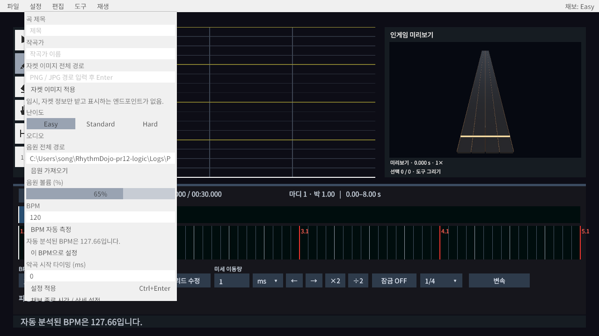
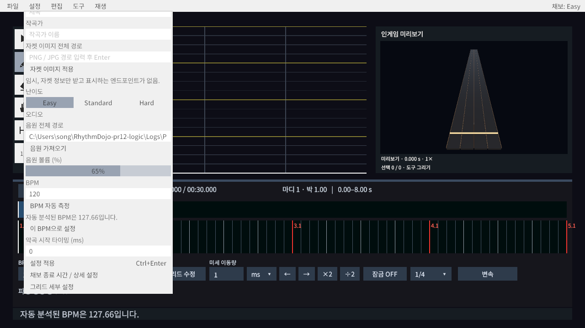

# PR #12 에디터 논리 수정 검증

2026-11-05 · Unity 6000.3.23f1 · Windows Editor / Pipeline 0.8.0-exp.1

PR 최신 커밋 `13cb86a69a23ae1d5e48b05b303c8227d5cb7bd6`에서 별도 작업 공간 `C:/Users/song/RhythmDojo-pr12-logic`, 브랜치 `fix/pr12-editor-logic`로 작업했다. 원래 main 작업 공간의 WorkspaceEditor, PlayKeyBindings, PlayKeyBindingsTests 수정은 건드리지 않았다.

## 최종 동작

1. 자동/수동 BPM 분석은 실제 BPM과 두 입력란을 바꾸지 않고 별도 문구와 **이 BPM으로 설정** 버튼을 제공한다. 적용은 첫 BPM 구간만 한 번의 Undo 단위로 변경한다. 오프셋, 후속 변속, 노트 시간은 보존한다. 제안은 편집·난이도 전환·일반 저장에 유지되며 적용, 음원 교체, 새 프로젝트/불러오기/다른 이름 저장 시 제거한다. 재분석은 이전 제안을 비우며 실패 이유를 표시한다. 세션, 음원, 분석 버전이 달라진 늦은 결과는 무시한다. 제안은 저장 형식에 추가하지 않았다.
2. 자켓 경로/적용 버튼 근처에 **임시, 자켓 정보만 받고 표시하는 엔드포인트가 없음.**을 고정 표시한다. 완료 메시지는 **자켓 정보를 반영했습니다. 이미지 표시는 아직 지원하지 않습니다.**이다. 기존 가져오기/저장을 유지하며 미리보기는 추가하지 않았다.
3. 루프 재시작 진입점은 일반 PausePreview와 분리되어 Ctrl+Space 시작점을 보존한다. 음원 끝의 자동 정지 이후 재시작도 포함한다. 일반 Space, 수동 탐색, 처음으로 정지 정책은 유지한다.
4. 재생 위치 드래그 중에는 재생을 유지하면서 자동 추적과 자동 루프 이동을 중단한다. 포인터를 놓으면 기존 추적 설정을 따른다. 영역 밖에서 놓기, Escape, 도구 전환, 포커스 상실, 컴포넌트/화면 비활성화·종료는 공통 정리 경로로 탐색 상태를 해제한다.

WorkspaceSceneBuilder와 저장된 ChartEditor 씬을 함께 반영했다. 기존 이름과 파일 저장 계약은 유지했다.

## 실행 결과

변경 후 Assets/Refresh로 재컴파일하고 아래 범위를 순차 실행했다. 각 실행 후 test_status의 완료 결과와 Play Mode 종료/Editor ready를 확인했다. 전체 모드 실행 결과가 아니라 관련 범위의 최종 결과다. 테스트별 최종 결과는 [JSON 기록](pr12-editor-logic-results.json)을 참조한다.

| 범위 | 최종 결과 | 확인 내용 |
| --- | --- | --- |
| BPM 관련 PlayMode | 5/5 | 실제 BPM 불변, 제안 유지, 버튼 적용/Undo, 후속 BPM/오프셋 보존, 직접 입력, 실패 음원 재생, 오래된 음원/프로젝트 분석 무시, 다른 이름 저장 시 초기화 |
| 자켓 PlayMode | 1/1 | 안내 문구 크기, 완료 메시지, 자켓 정보/볼륨 저장과 재로딩 |
| 루프 PlayMode | 2/2 | Ctrl+Space, 음원 끝 네 차례 반복, 0.5배 속도, 일반 Space, 수동 탐색/처음으로 정지 후 초기화 |
| 재생 위치 탐색 PlayMode | 3/3 | 음수 시간, 오프셋, 128→256→64 BPM, 스냅, 화면 고정, 추적 복구/OFF 유지, 영역 밖 실제 마우스 놓기, 루프 중단, 다섯 취소 경로 |
| 메뉴/도구 바인딩 PlayMode | 1/1 | 액션 참조, 단축키 표시, 도구/난이도 조작 |
| ChartEditor 글꼴 EditMode | 1/1 | 숨긴 컨트롤을 포함한 저장된 씬 글꼴 검사 |
| 저장소 지정 Smoke PlayMode | 4/4 | 타이틀 진입, 곡 로드, 시작/재시작/포커스 상실, Ready 복귀 |
| 저장된 씬 직접 검사 | 통과 | 제안 문구/버튼 참조, 적용 액션 연결, 비어 있는 임시 상태, 타임라인 필수 참조, 자켓 안내 크기 |

서로 다른 테스트 17개가 모두 최종 통과했다. 씬 직접 검사 스크립트는 [Pr12SceneCheck.cs](Pr12SceneCheck.cs), 결과는 [pr12-scene-check.json](pr12-scene-check.json)이다. 마지막 공백 정리 후 재컴파일 오류 0건, git diff --check 통과. 커밋 시 Unity 메타 파일 검사도 실행한다.

## 실패 및 재검증 기록

- CLI의 여러 이름을 `|`로 묶은 첫 요청은 0개를 선택했다. 이를 통과로 세지 않고 개별 이름/카테고리 필터로 실행했다.
- 최초 씬 생성 후 숨겨진 저장 확인창을 처리해 테스트를 시작했다.
- 합성 128 BPM 음원의 분석 결과는 127.66이었다. 정확히 128이라는 문구를 기대한 테스트를 기존 ±2 BPM 허용 오차에 맞춰 수정했다. 알고리즘은 변경하지 않았다.
- 교체 프로젝트 테스트에 필수 4레인 채보를 추가했고, 취소 반복 테스트는 직전 자동 추적으로 화면 밖이 된 클릭 위치를 화면 초기화 후 계산하도록 수정했다. 실패한 범위를 다시 실행해 통과했다.
- 재생 검사 중 별도 Editor의 DSP 시계가 멈췄다(0.2초 실시간 대기에도 DSP 변화 0, 재생 상태는 true). 해당 Editor에서 현재 AudioConfiguration으로 AudioSettings.Reset을 한 뒤 DSP 진행을 확인하고 재생 위치 관련 범위를 재실행했다. 제품 코드에 환경 우회는 넣지 않았다.
- 최종 검토에서 다른 이름 저장이 일반 Observe 경로를 우회함을 확인해 제안 초기화를 보완하고 해당 저장 테스트를 추가 검증했다.

## 실제 화면

128 BPM 합성 WAV를 가져온 실제 Play Mode 화면을 1280×720으로 캡처했다. 원래 BPM 120은 유지되며 분석값 127.66이 별도로 보인다. 설정 패널 상단/하단 스크롤 위치에서 자켓 안내, 제안 및 적용 버튼을 직접 확인했다. 합성 음원과 임시 작업 파일은 커밋하지 않는다.

## 미실행 범위

전체 EditMode/PlayMode, 전체 Foundation, Windows 플레이어 빌드는 실행하지 않았다. 변경은 에디터 화면·재생 조작과 해당 씬에 한정되며, 저장소 기준에 따라 관련 검사와 Smoke로 검증했다. 빌드 설정/패키지 변경은 없다.
