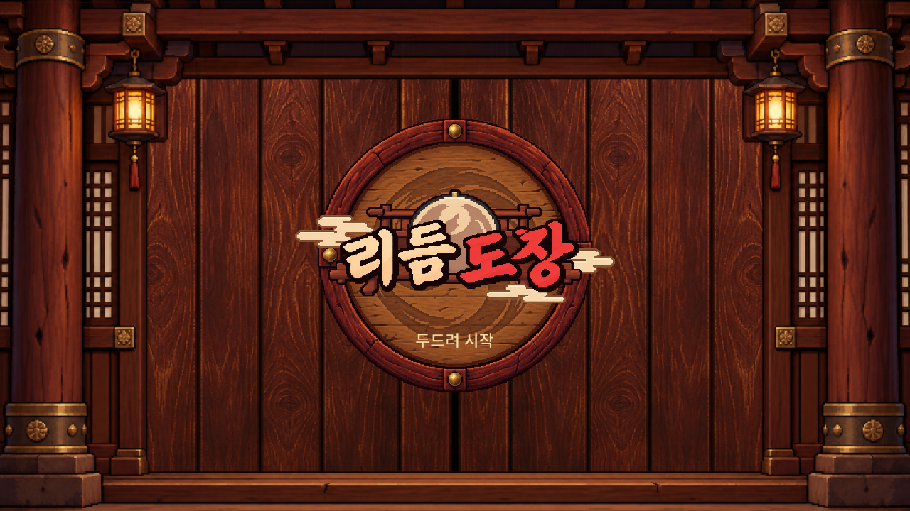

<h1 align="center">리듬도장 · Rhythm Dojo</h1>

  리듬게임이 뭔지 모르는 사람도 기초부터 심화까지 수련 할 수 있는 포근한 도장이 되고 싶습니다.

  
  
  

  <a href="#소개">소개</a> &nbsp; / &nbsp;
  <a href="Docs/getting-started.md">실행·조작</a> &nbsp; / &nbsp;
  <a href="Docs/development.md">개발 안내</a> &nbsp; / &nbsp;
  <a href="https://github.com/bipolarrr/rhythm-dojo/issues">버그·제안</a>

  

## 소개

리듬도장은 도장을 배경으로 하는 리듬 게임입니다. 음악에 맞춰 D · F · J · K 키로 입력합니다. (2026/10/22기준)

게임 안에서 직접 채보를 만들 수도 있습니다. 음원을 불러와 파형을 보며 노트를 배치하고, 바로 테스트 플레이를 한 뒤 돌아와 고칠 수 있습니다.

현재 Unity로 **개발 중**이며, 기본 수록곡은 테스트·데모 곡 위주입니다. 플레이와 채보 편집의 기본 기능을 갖추고 화면과 사용성을 다듬고 있습니다.

직접 빌드하려면 **Unity 6000.3.23f1**이 필요합니다. 설치 후 실행 방법과 조작법은 [실행 안내](Docs/getting-started.md)를 참고하세요.
